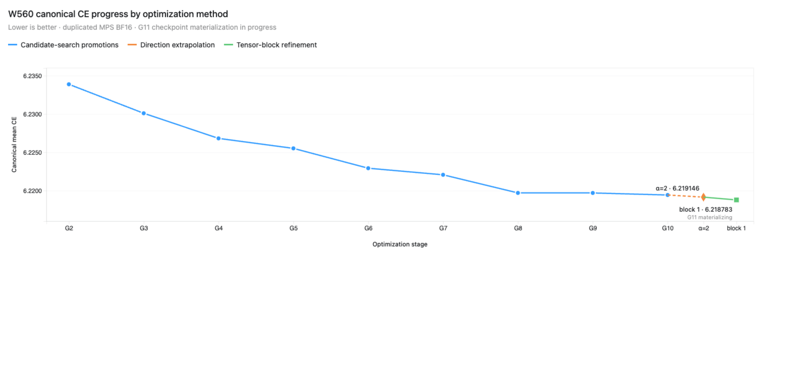
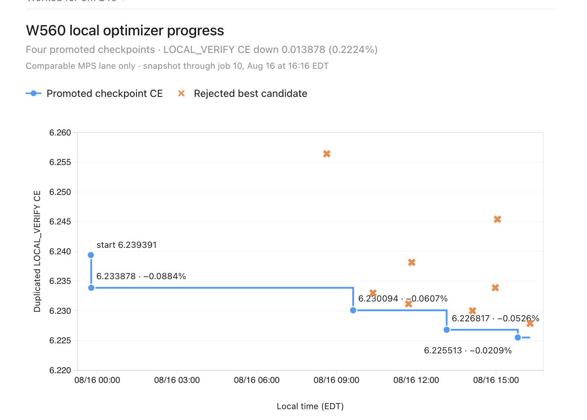

# Perturbation-based weight optimization

The August 2026 research contains a forward-only weight optimizer for the historical **W560 hierarchical function-weight GRU**. It has now been recovered into Super-1. This is executable solver/controller source with provenance, original tests, and saved decisions. It is separate from the current function-weight Transformer and minGRU experiments; no compatibility with those models is claimed.

## Source entry points

All paths below are in [the recovery bundle](results/perturbation-recovery-20261018-v1/).

- [Frozen solver: `branch_search.py`](results/perturbation-recovery-20261018-v1/source/hfw-w560-continuous-optimizer-20260815-v1r1/branch_search.py): `paired_spectral_trust_region_exact_v1_transfer`. The later definition of `_run_independent_branch_guarded` is the active definition; both historical definitions are preserved byte-for-byte.
- [Production bridge](results/perturbation-recovery-20261018-v1/source/hfw-w560-continuous-optimizer-20260815-v1r1/production_bridge.py) and [frozen protocol](results/perturbation-recovery-20261018-v1/source/hfw-w560-continuous-optimizer-20260815-v1r1/config/production_protocol.json): model binding, parameter groups, search budget and radius rules.
- [Continuous controller](results/perturbation-recovery-20261018-v1/source/hfw-w560-continuous-optimizer-20260815-v1r1/hfw_continuous/): proposal workers, serialized promotion, stale-head rejection, exact candidate storage and recovery.
- [Later MPS implementation](results/perturbation-recovery-20261018-v1/source/mps-runtime/): cumulative proposals and canonical MPS scoring, kept as a separate historical snapshot.
- [Import inventory](results/perturbation-recovery-20261018-v1/IMPORT.json): original SSD locations, destination paths, sizes and SHA-256 for all 137 imported files (1,860,841 bytes). All 85 frozen release files match the original [source manifest](results/perturbation-recovery-20261018-v1/provenance/frozen-release/source_manifest.v1.json). The later MPS snapshot is inventoried separately; that original 85-file guarantee does not cover its controller.

## How it changes weights

For each parameter group, the solver creates structured random perturbations: low-rank matrix directions and vector directions, scaled by effective-weight RMS. Each iteration scores the current weights and positive/negative perturbations along three directions. The paired losses estimate a directional derivative `(loss_plus - loss_minus) / (2 * radius)` using forward evaluations only.

The solver ranks directions, combines the two most promising signed directions, normalizes the combination, and tests line-search scales 0.5, 1.0 and 1.5. It accepts a qualifying improvement and adapts the trust-region radius. The frozen protocol assigns 18 iterations and 180 logical objective evaluations per branch, across separate `base_affines`, `left_factors`, `right_factors` and `codecs` branches. One logical objective evaluation can contain multiple model forward calls.

This is derivative-free weight optimization: it does not use backpropagation or Adam. Historical fields saying `optimizer_steps: 0` refer to conventional gradient optimizer calls, not the absence of weight updates. The runtime guard blocks autograd and PyTorch optimizer use. Search acceptance is provisional; the controller independently scores proposed candidates before promotion and preserves exact candidate bytes rather than reconstructing them through a rounded float32 delta.

## Preserved MPS results

The [August 22 ledger](results/perturbation-recovery-20261018-v1/evidence/mps-20260822/ledger/) contains three completed decisions and two heads. All available completed decisions from this located ledger are included, including both rejections. This is not a claim to have recovered every historical optimization run.

| Group | Candidates rescored | Parent mean CE | Outcome |
|---|---:|---:|---|
| base_affines | 14 | 6.222062796354294 | Rejected |
| left_factors | 16 | 6.222062796354294 | Candidate 4 promoted; CE 6.219697281718254 |
| right_factors | 16 | 6.219697281718254 | Rejected |

The single promotion reduced mean CE by about **0.0380%** and advanced generation 7 to 8. Every parent/candidate has two saved identical evaluations across 32 sequences. The numerical lane is MPS BF16 forwards with CPU FP64 functional normalization. The data is explicitly labeled **PERMANENT_REUSED_OPTIMIZATION_DATA_NOT_HELD_OUT**. These values show an improvement on the optimization objective, not held-out generalization, a multi-seed comparison or proof that perturbation search beats gradient descent. Losses from other historical numerical lanes must not be pooled with these values.

## Historical graphs

The two original user-supplied PNGs are preserved without alteration, with their hashes in [GRAPHS.json](results/perturbation-recovery-20261018-v1/GRAPHS.json).



The August 22 image shows candidate-search promotions G2–G10, direction extrapolation and tensor-block refinement. Its endpoint label is 6.218783 and explicitly says **G11 materializing**. This image alone does not establish a completed G11 checkpoint or promotion. The three-decision ledger audited above covers a narrower continuation and does not independently validate the complete plotted trajectory or the later extrapolation/refinement methods.



The August 16 image reports four promotions, a displayed mean CE decline from 6.239391 to 6.225513 (0.2224%), and rejected candidates through job 10. These are claims shown in the historical image, not a new numerical replay. The chart is explicitly restricted to its comparable MPS LOCAL_VERIFY lane. Neither chart establishes held-out generalization. We have not digitized the pixels into invented raw measurements or pooled the charts with other numerical lanes.

## What was verified during recovery

- Original 85-file release bindings and all 137 imported file hashes/sizes match.
- All 89 imported Python files parse, and all 44 imported JSON files load.
- Saved content-addressed heads/decisions, parent/child checkpoint identifiers, 46 candidate score means, duplicate equality, thresholds and winner selection pass a read-only audit.
- All **11 original frozen CPU toy/integrity tests pass**. They cover solver preservation, candidate bytes, stale heads, tampering, disk gates and recovery. See [fresh test receipt](results/perturbation-recovery-20261018-v1/TOY_TESTS.json) and [log](logs/perturbation-recovery-20261018-v1/frozen-integrity-tests.log).

The [audit receipt](results/perturbation-recovery-20261018-v1/VERIFICATION.json) is fresh verification of imported files and saved arithmetic. It does not replay W560 inference. No new language training, MPS run, cloud job or continuous optimizer was launched. The later MPS test suite has not been rerun because its real checkpoint/token dependencies were not included.

From the repository root, run the standard-library-only audit:

```sh
python3 -B auto-research/results/perturbation-recovery-20261018-v1/verify_recovery.py
python3 -B scripts/verify_evidence.py
```

To rerun the original toy tests in an environment with PyTorch, keep the checkout and temporary output on a mounted writable SSD:

```sh
cd auto-research/results/perturbation-recovery-20261018-v1
mkdir -p verification-tmp
export TMPDIR="$PWD/verification-tmp"
export PYTHONDONTWRITEBYTECODE=1
export OMP_NUM_THREADS=1 MKL_NUM_THREADS=1 OPENBLAS_NUM_THREADS=1 VECLIB_MAXIMUM_THREADS=1
cd source/hfw-w560-continuous-optimizer-20260815-v1r1
python3 -B tests/run_integrity_tests.py
```

## Dependencies and execution boundary

Original and promoted W560 checkpoints, token arrays, and proposal tensor payloads remain external. Historical receipts retain their paths and hashes; this recovery has not revalidated those payloads. The source bundle is therefore inspectable and toy-testable, but not a self-contained W560 benchmark replay. The imported nanoGPT model retains its upstream license.

Historical absolute paths, authorization flags and dates are preserved as evidence. They are not current launch authorization. Any resumed optimization needs exact model/data binding, an explicit resource scope and a separately approved protocol. Importing this optimizer does not enable it in the current model, change a default optimizer or silently replace an architecture.
