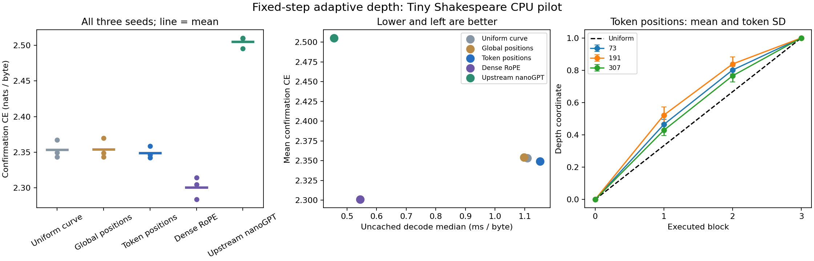

# Fixed-step adaptive depth pilot: adaptive-depth-shakespeare-20261018-v1

Status: COMPLETED. Decision: **NO_PROMOTION_INCONCLUSIVE_OR_NEGATIVE**.

## Question and controls

Does choosing ordered weight-curve sampling positions from each token improve held-out byte prediction with the same number of executed blocks? Uniform positions are the primary comparator. Learned global positions isolate whether token conditioning itself matters. Dense RoPE and byte-exact upstream nanoGPT provide external controls. This extends the cubic projection curve; it does not change the historical recurrent hierarchy.

## What actually ran

User authorization: current-chat “ok do it” following the proposed fixed-step experiment. Preregistration commit: `5460ec90ac4b5fe3e6c97656280ed27390ee31b3`. Protocol SHA-256: `6c03bd561e22dcf61d2e023801a6694f955ca50158f1c4fe6639d687c5db77a4`.

Five arms x three paired seeds (73, 191, 307), each with 600 AdamW updates and 307,200 next-byte targets; 4,608,000 total training targets. Width 48, 4 blocks, 4 heads, training/evaluation context 64 bytes. One LR recipe and final-checkpoint selection for every arm. CPU FP32, one intra-op and inter-op thread, no cloud or GPU.

Tiny Shakespeare uses a fixed 256-byte vocabulary. Contiguous source regions are 80% training, 10% selection, 10% confirmation. The endpoint scores the first 256 nonoverlapping 65-byte chunks of confirmation (16,384 targets); monitoring scores 4,096 selection targets. It does not score the whole reserved region. The public corpus snapshot, exact boundaries, source/data hashes and runtime are included. No teacher or official benchmark test was used.

All 15 final checkpoints were frozen before confirmation scoring. Every endpoint was evaluated twice with exact FP32 CE and logit hashes, then independently replayed by verify_results.py. All arms improved monitoring CE from initialization. No LR sweep, early-stop selection, retraining, or confirmation-based repair occurred.

## Results

Lower CE is better. These are byte losses, not word perplexity or accuracy.

| Arm | Parameters | Seed 73 | Seed 191 | Seed 307 | Mean CE |
|---|---:|---:|---:|---:|---:|
| Uniform curve | 68,905 | 2.343601 | 2.349248 | 2.367483 | 2.353444 |
| Global positions | 68,905 | 2.343457 | 2.348721 | 2.369868 | 2.354015 |
| Token positions | 68,905 | 2.342518 | 2.346519 | 2.358562 | 2.349200 |
| Dense RoPE | 123,744 | 2.314121 | 2.304836 | 2.283577 | 2.300845 |
| Upstream nanoGPT | 126,384 | 2.510472 | 2.509830 | 2.495276 | 2.505193 |

Differences below are token-conditioned minus comparator; negative favors token conditioning. The prespecified useful effect is at least 0.02 nats/byte, with all three gaps negative and a descriptive paired-t 95% upper bound below zero. The n=3 intervals have unverified normality and cover seed variability on one shared text region, not corpus-generalization uncertainty.

| Comparator | Seed gaps | Mean gap | Descriptive 95% interval |
|---|---|---:|---|
| Dense RoPE | +0.028397, +0.041683, +0.074986 | +0.048355 | [-0.011265, +0.107975] |
| Uniform curve | -0.001083, -0.002729, -0.008921 | -0.004244 | [-0.014510, +0.006022] |
| Global positions | -0.000940, -0.002202, -0.011306 | -0.004816 | [-0.018866, +0.009234] |
| Upstream nanoGPT | -0.167954, -0.163311, -0.136713 | -0.155993 | [-0.197869, -0.114117] |

Primary fixed comparison passed: **False**. Token-specific control passed: **False**. Combined dense/nanoGPT gate passed: **False**.

## Deployment measurements

CPU measurements use fresh processes per checkpoint, batch 1, 5 warmups and 30 repetitions. Prefill scores 64 bytes. Decode generates 16 bytes from a common 32-byte prompt by recomputing the entire prefix each time; no KV cache is implemented. Table shows means across seeds of within-process medians/p95. Concurrent unrelated host work can affect wall latency; these are implementation-specific pilot measurements.

| Arm | Weight KiB | Prefill p50 / p95 ms | Decode p50 / p95 ms per byte | Process peak MiB | Training CPU s |
|---|---:|---:|---:|---:|---:|
| Uniform curve | 269.2 | 1.300 / 1.915 | 1.108 / 1.292 | 194.2 | 9.28 |
| Global positions | 269.2 | 1.281 / 1.580 | 1.098 / 1.188 | 196.4 | 9.07 |
| Token positions | 269.2 | 1.296 / 1.746 | 1.152 / 1.345 | 194.8 | 9.41 |
| Dense RoPE | 483.4 | 0.726 / 0.967 | 0.544 / 0.607 | 197.0 | 6.88 |
| Upstream nanoGPT | 493.7 | 0.604 / 0.733 | 0.455 / 0.489 | 188.3 | 5.90 |

Process peaks include Python/PyTorch, checkpoint loading, data and workspaces, not just model memory. Initial process peaks are retained in raw metrics. Separate activation-only/allocator peaks were not measured. There is no quantization or GPU memory result. Curve arms execute two basis matmuls per projection; dense controls execute one. The fixed arm deliberately uses the same basis execution path for mechanism comparison, rather than an optimized prematerialized static weight matrix. Equal block count and fewer weights are not equal FLOPs or optimized inference.

## Mechanism diagnostics and limitations

Endpoints remain 0 and 1; internal increments are positive. The router starts with zero output so all three curve arms begin with the same uniform positions and base weights. Per-block normalization remains unchanged. Fixed includes an inert router; global lacks token input, so equal stored counts do not mean equal effective conditional capacity. Token-specific claim requires beating that global control.

| Seed | Token positions mean | Token positions SD | CE after forcing uniform positions |
|---:|---|---|---:|
| 73 | 0.000000, 0.464396, 0.801277, 1.000000 | 0.000000, 0.031834, 0.023116, 0.000000 | 2.344034 |
| 191 | 0.000000, 0.522431, 0.838704, 1.000000 | 0.000000, 0.050988, 0.043232, 0.000000 | 2.347652 |
| 307 | 0.000000, 0.428522, 0.765415, 1.000000 | 0.000000, 0.031752, 0.036665, 0.000000 | 2.359335 |

Uniform-position intervention is a post-training diagnostic declared before training; it is not an independently trained control and does not replace the primary endpoint. The current short-budget, single-domain byte task and 64-byte context cannot establish broader language quality, reasoning ability, transfer, convergence, novelty or SOTA. Models are not parameter- or FLOP-matched across curve and dense families; shared width/depth and exposure isolate the within-curve comparison.

## Decision and next experiment

Token conditioning lowered CE on all three seeds, but its mean gain over uniform positions was only 0.004244 nats/byte, below the frozen 0.02 threshold, with an interval spanning zero. Its advantage over upstream nanoGPT was already largely present in the fixed curve. Dense RoPE had lower CE on every seed and roughly half the measured uncached decode latency. Therefore the nanoGPT result does not establish an adaptive-sampling advantage.

The frozen decision is **NO_PROMOTION_INCONCLUSIVE_OR_NEGATIVE**. Preserve these outcomes without promoting the adaptive model or changing thresholds. No extra seeds, training, cloud resources or automation are started by this result.

A follow-up should first determine whether a well-trained nonconstant curve provides a useful depth landscape: compare token-conditioned and global routing while freezing the same pretrained curve, on a new preregistered confirmation region. That would separate weak curve differentiation during scratch training from routing usefulness; it is a proposal only, not evidence of the explanation. Measure its cost before a larger language run.

## Integrity and cleanup

Training/evaluation parent process: 128.51 CPU seconds and 156.30 wall seconds. Isolated benchmark subprocess CPU totals: 7.58 seconds, separately accounted. Resource bounds were 900 CPU seconds, 1,800 wall seconds and 100 MiB new run artifacts. Terminal receipt records actual bytes at completion.

The initial FP32 finite-difference canary suffered cancellation (zero numerical estimate). Before training, it was strengthened to FP64 and passed at absolute error below 1e-8; both receipts are retained. The original reference passes forward, gradient and AdamW-step parity with nonconstant coefficients. Nonzero routing also passes exact causal-prefix checks. No frozen training source changed after the preregistration freeze; reporting and independent verification tools were added afterward.

All checkpoints, corpus snapshot, immutable protocol, source manifest, raw progress, duplicate results, independent verification and figure inputs are preserved. Disposable runtime/font caches are excluded from Git and stored only on the SSD. Original workspace changes and historical evidence are preserved. No cloud resources were created; cleanup receipt is local-only.

## Reproduction

From the repository root with Python 3.9 and PyTorch 2.8.0:

```bash
python3 -B auto-research/results/adaptive-depth-shakespeare-20261018-v1/verify_results.py
python3 -B auto-research/results/adaptive-depth-shakespeare-20261018-v1/run.py --output "/Volumes/SP AI 01_16/CodexWorkspaces/YOUR_FRESH_REPLAY_DIRECTORY"
```

The second command retrains and therefore requires an authorized fresh resource envelope and an unused SSD destination. Source hashes are checked; outputs refuse overwrite. Training order is shuffled deterministically per seed, and source/config/checkpoint identities are preserved.


