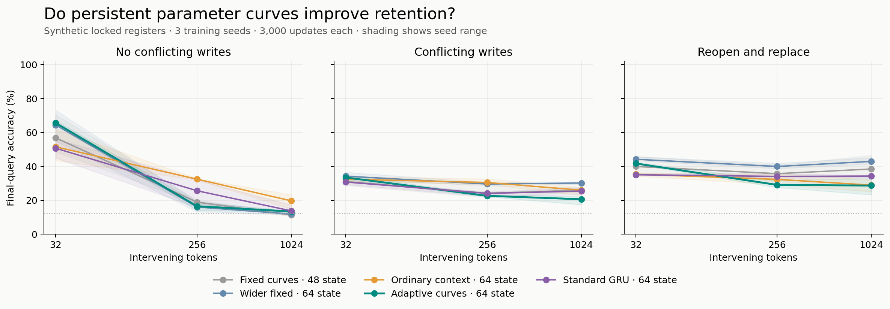
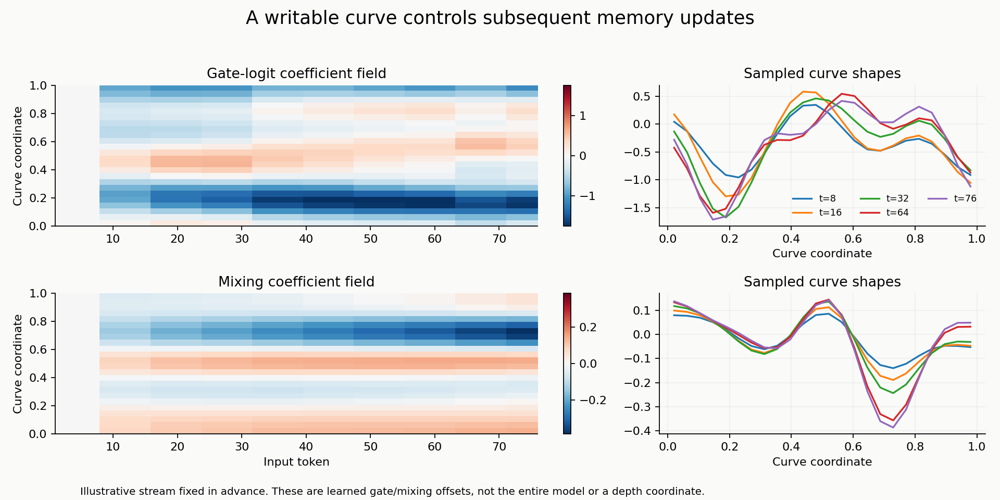

# Persistent curve parameters: short-horizon gains, failed retention gate

**Decision: no promotion.** All 15 main runs completed and all saved primary-delay endpoints replayed exactly. The adaptive parameter-curve arm lost to the exactly parameter/state-matched ordinary-context control on all three training seeds. This is a negative result for this specific first design, not a rejection of curve representations or self-modifying models.

The tested model makes 16 persistent coefficients control gate biases and pair mixing. The updater weights themselves remain fixed at inference; full self-reference, cross-episode learning, variable depth, consolidation, and language retention were not tested.

## Primary endpoint: conflicting writes after 256 intervening tokens

| Arm | Seed 101701 | Seed 101702 | Seed 101703 | Mean | Trainable parameters | FP32 state bytes |
|---|---:|---:|---:|---:|---:|---:|
| Fixed curves · 48 state | 22.27% | 21.68% | 28.52% | 24.15% | 7,552 | 192 |
| Wider fixed · 64 state | 28.91% | 29.30% | 30.47% | 29.56% | 9,256 | 256 |
| Ordinary context · 64 state | 29.30% | 29.49% | 32.62% | 30.47% | 10,144 | 256 |
| Adaptive curves · 64 state | 23.24% | 22.07% | 22.46% | 22.59% | 10,144 | 256 |
| Standard GRU · 64 state | 22.27% | 24.80% | 25.00% | 24.02% | 22,280 | 256 |

Adaptive minus matched context: **-7.88 percentage points**, with paired differences -6.05, -7.42, -10.16 points. The predeclared +5-point/all-seeds-positive rule failed. Three training seeds support a consistent result within this experiment; they do not establish broad architecture superiority. Chance accuracy is 12.5%.

The matched context control retained locked values at 26.04%; the adaptive arm reached14.06%. Neither solved the task reliably. Inadequate learning of the conditional write rule and the short training horizon limit the strength of architectural conclusions.

## Delay and replacement results

| Condition | Matched context | Adaptive curves |
|---|---:|---:|
| No conflicting writes,32 tokens | 51.50% | 65.56% |
| No conflicting writes,256 tokens | 32.42% | 16.47% |
| No conflicting writes,1,024 tokens | 19.66% | 13.35% |
| Conflicting writes,256 tokens | 30.47% | 22.59% |
| Reopen and replace,256 tokens | 32.29% | 29.04% |

Training delays were8/16/32 tokens. The32-token endpoint is within the trained range;256 and 1,024 are extrapolation. Short-delay no-conflict recall favored adaptive curves over the matched context arm, but the wider fixed cell was close (64.39% versus65.56%). Thus the short gain does not establish that persistent parameter modulation is necessary.

The short reopened-key accuracy gap favored adaptive curves by12.50 points; this passed the secondary replacement safeguard but did not rescue the failed primary retention gate. Reopen-table accuracy averages all four final keys; the safeguard uses only the explicitly reopened key.

## Registered mechanism interventions

These are evaluation-time changes to trained adaptive models, not retrained ablations. They are diagnostic and distribution-shifting. The base token-conditioned mixer remains active in the no-mixing-modulation intervention.

| Adaptive model intervention | No conflicting writes,256 | Conflicting writes,256 | Reopen/replace,256 |
|---|---:|---:|---:|
| None | 16.47% | 22.59% | 29.04% |
| Zero both coefficient fields | 13.02% | 27.86% | 39.52% |
| Disable adaptive gate modulation | 13.87% | 26.89% | 36.20% |
| Disable adaptive mixing modulation | 13.41% | 22.59% | 28.12% |

Gate modulation is the more concerning path for conflicting writes in this run: disabling it raises accuracy from 22.59% to 26.89%; disabling mixing modulation alone leaves the rounded aggregate unchanged. Zeroing both gives27.86%. This does not show that a gate-only model trained from scratch would behave the same, nor that mixing is universally harmless. For no-conflict retention, all removal interventions reduce the already-low adaptive score.

The example stream and first training seed were fixed before plotting, not selected for correctness. The fields are smooth cosine functions over hidden-coordinate pairs. They are not the whole model, a token-time Fourier spectrum, or a continuous depth coordinate.

## Fidelity, resources, and preservation

- Zero adaptive updates reproduce the fixed48 model exactly; the ordinary-context extension does too.
- Nonzero-controller chunk carry and causal-prefix comparisons match exactly. A float64 finite-difference check of an active updater weight agrees within 1.98e-11 absolute gradient error.
- An independent scalar simulator confirms the task labels. All five arms consume exactly identical examples, query targets, and input-token counts within each training seed.
- Every main checkpoint completed 3,000 optimizer updates. All 15 primary-delay evaluations replay exactly from saved FP32 checkpoints, including per-episode outcomes.
- Main training consumed 11.81 aggregate CPU minutes. Main launch including evaluation took 4.50 wall minutes with at most3 workers and 1 PyTorch thread per worker. No deployment-speed claim is made.
- The primary pair shares 10,144 trainable parameters and 64 FP32 state scalars. The state-byte count excludes weights, basis buffers, activations, and workspaces; a shared integer clock is additional. Standard GRU has more parameters. Compute and wall time were not matched.
- All five 250-update pilot outcomes are retained separately. Pilot and main evaluation seeds differ. Protocol/source hashes were frozen locally before main training; subsequent Git publication is not independent preregistration.
- Source, metrics, reports and figures are submitted to the user’s own fork. All 20 pilot/main checkpoints, every full-step trace, and the example curve trace are in the companion archive; hashes and preservation receipt identify it.
- The original local macOS SSD instruction belongs to a different host. This run used the explicitly supplied conversation workspace and durable companion artifact; it does not claim to have mounted that SSD.
- No official test, external corpus, teacher, GPU, paid provisioning, or language-model evaluation was used. No process remains running after completion.

## Next experiment

Do not add variable depth or full recursive weight updates yet. First establish reliable conditional-write learning with a stronger task-learning control, then test a bounded residual gate update initialized from an already competent fixed model. Pair that with ordinary context feedback, longer no-overwrite training intervals, and a replay/functional-drift penalty. Train gate-only and mixing-only changes separately rather than inferring their training behavior from the interventions here.

This follow-up is a proposal, not a running job. A small matched synthetic comparison can use the same CPU envelope; natural-language retention requires a separate transfer study.

Protocol SHA-256: `38efa9efac4ef453700aed3e543636da0f09e0bf0f0c41d737c1047f1ccc20f3`. See [reproduction and mechanism](../results/curve-inception-20261017-v1/README.md), [raw summary](../results/curve-inception-20261017-v1/SUMMARY.json), and [replay checks](../results/curve-inception-20261017-v1/REPLAY_CHECKS.json).
