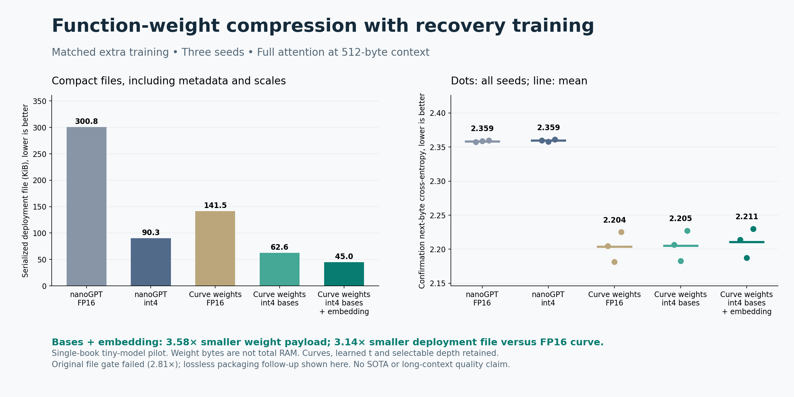

# Packed function-weight compression with recovery training

Quantizing shared function bases and the tied embedding/output to4-bit reduced weight tensor bytes **3.575x**, with **0.684% higher mean perplexity** than the matched FP16 recovery control. A lossless packaging follow-up reduced deployment files **3.145x** using identical compact serialization for both quantized and FP16 controls. The original torch-file3x gate failed and remains failed.

The original full-rank shared bases, cubic coefficient functions, token-conditioned t router and selectable inference depth are preserved. KV stays full attention throughout. No hierarchy changes were made.

## Fresh confirmation results

Next-byte CE on the same5632 targets at512-byte context; lower is better. Means cover seeds73/191/307. Selected rounds were frozen before confirmation.

| Arm | Mean CE | Zero-recovery CE | Weight payload, bytes | Torch file, bytes | Compact file, bytes | Selected rounds |
|---|---:|---:|---:|---:|---:|---|
| curve_fp16 | 2.203687 | 2.220164 | 137,810 | 151,418 | 144,941 | [3, 3, 3] |
| curve_b4 | 2.205467 | 2.223755 | 56,594 | 71,720 | 64,080 | [2, 3, 3] |
| curve_be4 | 2.210507 | 2.233789 | 38,546 | 53,925 | 46,088 | [2, 3, 3] |
| nano_fp16 | 2.358518 | 2.363759 | 300,096 | 317,959 | 307,974 | [3, 3, 3] |
| nano_q4 | 2.359474 | 2.368773 | 83,520 | 105,617 | 92,507 | [3, 3, 3] |

Primary contrast: curve_be4 minus matched FP16 curve recovery control CE+0.006820; paired95% t interval[+0.001033,+0.012607]. Every seed and the upper interval bound pass the preset2% perplexity tolerance. Relative to the original FP32 teacher, recovered curve_be4 improves mean perplexity by0.962%; the teacher received no extra recovery training, so that is not a compression-caused quality gain.

| Seed | FP16 curve CE | Int4 bases + embedding CE | Relative PPL change |
|---|---:|---:|---:|
| 73 | 2.204568 | 2.213974 | +0.945% |
| 191 | 2.181297 | 2.187466 | +0.619% |
| 307 | 2.225196 | 2.230081 | +0.490% |

The quantized nanoGPT control preserves its own quality (+0.096% mean perplexity versus its FP16 recovery control). The compact curve deployment is2.007x smaller than compact quantized nanoGPT and has lower CE on this passage. These are different tiny architectures (68,905 versus150,048 unique parameters, different position encodings); the result does not isolate a universal superiority of function weights or reproduce the optimized nanoGPT speedrun.

## Total RAM is a different result

Fresh workers load only deployment files and run one512-token full-attention forward. Process peak RSS is dominated by Python/PyTorch, activations and workspaces; there is no dramatic total-process RAM saving in this tiny-model experiment. Host timings and RSS are diagnostic, not controlled speed benchmarks.

| Compact arm | Peak RSS across three fresh workers, MiB |
|---|---|
| curve_fp16 | 182.52, 182.58, 182.66 |
| curve_b4 | 182.67, 183.98, 183.56 |
| curve_be4 | 182.61, 183.58, 182.20 |
| nano_fp16 | 179.81, 181.78, 159.94 |
| nano_q4 | 182.25, 181.19, 182.06 |

## Storage implementation and preserved failure

Each unique shared basis is stored once. Int4 values use two signed-offset nibbles per byte with one FP16 scale per64 values. The tied embedding/output stays tied. Curve coefficients, router, normalization and biases remain FP16. This yields38,546 bytes including scales/padding, versus137,810 FP16 bytes. Recovery masters and optimizer states remain in research checkpoints; deployment never loads them.

Inference decodes up to16 output rows at a time, with a maximum12,288-byte FP32 decoded weight tile in this model. That excludes integer indices, intermediate tensors and activations. It never reconstructs or retains all FP32 matrices. It uses FP32 attention/activations and ordinary CPU operations; this is not an optimized integer kernel or cached incremental serving implementation.

Initial `.packed.pt` files were53,925 versus151,418 bytes (2.808x), failing the original3x serialized-storage target despite passing quality. A separately committed, post-result **lossless packaging follow-up** replaces individual tensor ZIP records with typed views into one byte buffer. Under the same new format, curve_be4 is46,088 versus144,941 bytes (3.145x). All15 selected exports, including every control, were converted with exact tensor and confirmation-logit round trips. This is not new quality evidence and does not turn the original gate into a pass. Basis-only quantization still misses3x storage.

## Protocol and verification

- Protocol/config/source/checkpoint hashes committed at96f7d72 before training. Recovery completed with60 checkpoints and30 original packed exports in113.35 CPU seconds/121.86 wall seconds on one CPU thread.
- All five arms per seed ran120 identical minibatches (122,880 extra targets), CE plus frozen-original-teacher KL, AdamW, three rounds. Selected quantized curve checkpoints use80 updates for seed73 and120 for the other seeds; control selections use120. Training budgets, rather than selected checkpoints, are matched.
- Train[0,110000), validation[110000,114128), fresh confirmation[114128,119771). Same-book adjacent regions and reused validation limit generalization. Three seeds do not estimate corpus uncertainty.
- All60 checkpoint hashes and validation selections were audited. All30 original packed exports independently reproduce confirmation logits exactly.27 trained depth2/3/4 cases preserve packed/fake logits and sampled t; quality is validated only at depth4.
- Packaging protocol/code committed at160d243 before conversion. All15 compact exports preserve tensors and confirmation logits exactly. Each format has15 fresh-process RAM receipts.
-13 runtime/profile/archive unit tests,13 existing library checks and5 existing depth checks cover regressions. Original function-weight sources remain unchanged.

## Reproduction and next steps

The [experiment directory](../results/function-weight-int4-20261018-v1/) retains protocols, immutable results, rejected rounds, masters and packed deployments. Run `python3 -B auto-research/results/function-weight-int4-20261018-v1/verify.py --output /absolute/SSD/path/to/new-replay.json` from the repository root for an independent packed replay. The output must be new. Do not rerun training into the frozen execution directory.

[LIBRARY.json](../results/function-weight-int4-20261018-v1/LIBRARY.json) binds all15 experimental compact profiles to hashes and selected checkpoints. [PACKED_WEIGHTS.md](../../sampling_library/PACKED_WEIGHTS.md) documents loading. [FUNCTION_WEIGHTS_HANDOFF.md](../../FUNCTION_WEIGHTS_HANDOFF.md) records progress and continuation instructions.

Next: broader held-out text and larger models with the same matched quantized nanoGPT control, followed by integration with cached function-weight/hierarchical-KV inference and measurement of joint weights+cache peak RAM. Establish those before lower-bit learned codebooks or activation-aware low-rank residuals. This pilot does not establish SOTA,70B feasibility, useful100K context, compressed cached-serving performance or production readiness.
