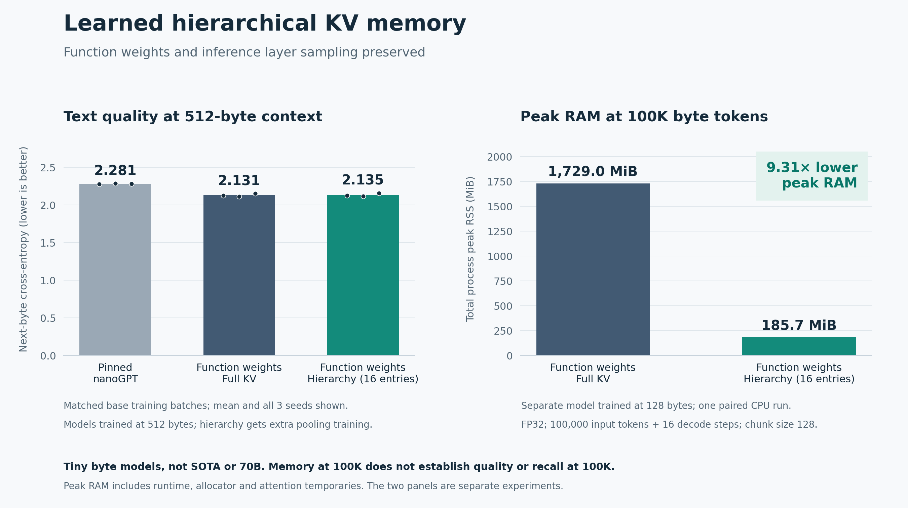

# Learned hierarchical KV memory with function weights preserved

Two bounded local CPU experiments trained the original function-weight curve model and a pinned upstream nanoGPT reference from scratch on identical text batches. Three seeds, four layers, width 48, four heads, UTF-8 bytes and FP32 were used throughout. Hierarchy changes only KV storage/readout. The learned token-conditioned sampling router, curve/basis projections, normalization, residuals and MLP remain present. During pooling adaptation every backbone/router parameter was frozen and fingerprint-checked.

The result is promising for a small text workload, not a SOTA result. No 70B model was trained or measured. The original full training run and its checkpoints were not replaced.

## Matched text quality

Lower next-byte cross-entropy is better. Columns are separate experiments and separate confirmation regions; do not compare the columns as a learning curve.

| Model |128-byte context mean CE|512-byte context mean CE|
|---|---:|---:|
|Pinned upstream nanoGPT|2.292273|2.280836|
|Function weights, full attention|2.096122|2.131311|
|Same function weights, trained 16-entry hierarchy|2.091875|2.134549|
|Same function weights, trained 32-entry hierarchy|2.092026|2.129947|

Each backbone received 614400 target exposures per seed. The hierarchy received additional CE+teacher-KL training: 15360 targets per capacity/seed in the 128 run and 30720 in the 512 run. Only 576 pooling parameters were added. Checkpoint rounds were selected on validation and all choices frozen before confirmation. LR was halved when a round failed to improve selection loss. All zero-init controls and rejected rounds are retained.

The 16-entry capacity was selected before confirmation in both runs. It passed the preset 2% PPL noninferiority gate versus both full curve and nanoGPT across seeds, including the paired upper 95% bound; the 512 run also passed a latter-half token gate. At 512, its mean PPL overhead versus full curve was 0.324%.

This is equal base data exposure, not equal compute or parameter count. The full curve has 68905 unique stored parameters; hierarchy has 69481. NanoGPT has 131616 at 128 context and 150048 at 512, including learned positional embeddings. Curve projections evaluate multiple bases, so fewer parameters do not imply fewer FLOPs. The models have different position encodings. This pinned nanoGPT implementation is not the optimized FineWeb speedrun.

## Fresh continuous 8K passage

After freezing the 512-context candidates, a separate preregistered 8192-byte passage at 144000:152193 was evaluated twice per seed, exactly reproducibly. No choices or gradients used this passage.

| Backend on the same function-weight backbone |Mean CE|
|---|---:|
|Full KV|2.386122|
|Trained 16-entry hierarchy|2.182517|
|Trained 32-entry hierarchy|2.181351|

The preselected 16-entry candidate passed the all-token and latter-half 2% PPL gates versus full KV. This is one passage with three training seeds, not three independent text samples. Full attention extrapolates far beyond the 512-byte training length. Compression may improve that extrapolation; this does not demonstrate superior retention of distant facts. There is no matched 8K nanoGPT or sliding-window control, no retrieval benchmark, and no 100K quality test.

## Actual 100K memory mechanics

A separate preregistered extension used the frozen 128-context seed 73 model with 100000 byte tokens plus 16 decode tokens. The measurements below come from two fresh processes on one CPU thread, FP32, chunk 128. These weights differ from the 512-context quality experiment above. They are not 70B estimates.

| Measurement | Full KV |16-entry hierarchy |
|---|---:|---:|
|Total process peak RAM|1729.000 MiB|185.703 MiB|
|Retained KV tensors|146.508 MiB|0.023 MiB|
|Prefill|154.163 s|17.426 s|
|Median of 16 decode steps|13.839 ms|1.056 ms|

Peak process RAM was **9.31x lower** in this 100K mechanics measurement. The full-KV implementation's temporary attention buffers and allocator behavior contribute to this ratio. It is specific to this CPU runtime; optimized GPU/Metal implementations can differ. Single paired run timings are descriptive, with other research processes on the host, not a controlled speed benchmark.

The original preregistered 4x total-memory gates at 128/512 and 8192 failed and remain failed. The 100K extension does not retroactively replace those gates. Neither library is automatically promoted. Quality at 100K, standard language-model benchmarks, larger models, multi-document workloads and long-range recall remain unproven.

## Evidence and reuse

- [128 protocol](../results/function-kv-text-descent-20261018-v1/PROTOCOL.json), [summary](../results/function-kv-text-descent-20261018-v1/execution/SUMMARY.json), [100K protocol](../results/function-kv-text-descent-20261018-v1/LONG_CONTEXT_PROTOCOL.json).
- [512 protocol](../results/function-kv-text-descent-512-20261018-v1/PROTOCOL.json), [summary](../results/function-kv-text-descent-512-20261018-v1/execution/SUMMARY.json), [8K protocol](../results/function-kv-text-descent-512-20261018-v1/LONG_QUALITY_PROTOCOL.json), [8K result](../results/function-kv-text-descent-512-20261018-v1/execution/long-quality/RESULT.json).
- [Explicit 128 library](../results/function-kv-text-descent-20261018-v1/LOADABLE_LIBRARY.json), [explicit 512 library](../results/function-kv-text-descent-512-20261018-v1/LOADABLE_LIBRARY.json), [reproduction and loading](../results/function-kv-text-descent-20261018-v1/REPRODUCE.md).

All 96 round checkpoints are preserved, along with 36 isolated short/8K memory workers, the two 100K workers, exact duplicate confirmation checks, nine duplicated 8K quality cases and independent library reload checks. The next useful step is a broader held-out corpus with long-context training, a simple sliding-window control, and explicit distant-fact retrieval evaluation before any laptop-scale/SOTA claim.
