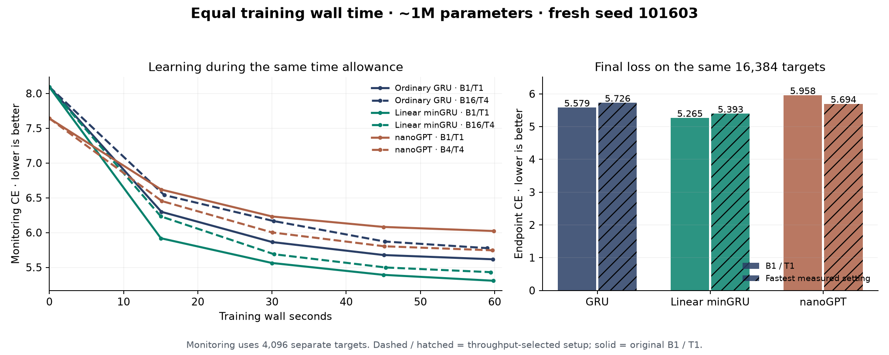
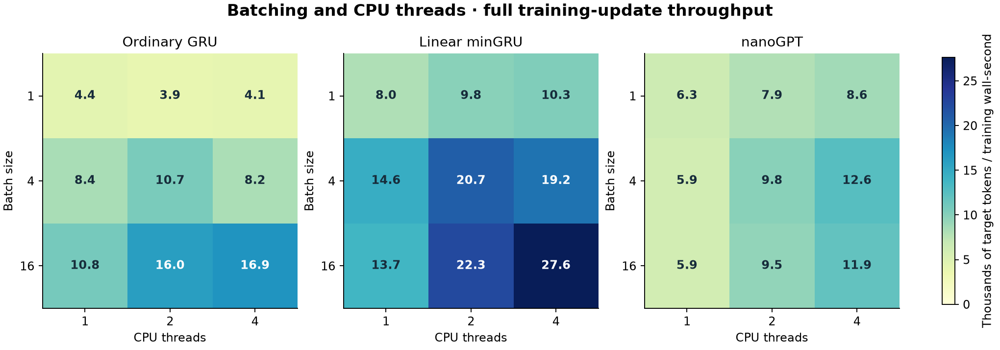

# Batching, threads and equal-wall-time learning

The best endpoint in this short screen is **Linear minGRU at batch 1 / 1 CPU threads: CE 5.264742**. All six fresh runs receive a 60-second training-wall allowance, with their actual stopping times below. Throughput and learning efficiency are measured separately: faster token processing does not guarantee the lowest loss under the common optimizer recipe.

This independent explorer study and its PR target **JRowe47/Super-1 → main**. Upstream submission requires the user's explicit go-ahead. The PR also contains the preceding unmerged longer-GRU and equal-CPU studies through its ancestry.

## Results

| Model | Batch / threads | Updates | Target exposures | Training wall s | Training CPU s | Final CE ↓ |
|---|---:|---:|---:|---:|---:|---:|
| Ordinary GRU | 1 / 1 | 537 | 274,944 | 59.77 | 59.7 | 5.579013 |
| Ordinary GRU | 16 / 4 | 121 | 991,232 | 58.98 | 223.2 | 5.726377 |
| Linear minGRU | 1 / 1 | 1,084 | 555,008 | 59.82 | 59.9 | 5.264742 |
| Linear minGRU | 16 / 4 | 189 | 1,548,288 | 59.47 | 219.7 | 5.392680 |
| nanoGPT | 1 / 1 | 646 | 330,752 | 59.89 | 59.9 | 5.958117 |
| nanoGPT | 4 / 4 | 361 | 739,328 | 59.70 | 237.3 | 5.694122 |

Every row uses approximately 1M parameters, initialization seed 101603, a common ordered FineWeb-Edu training-window stream, context 512, FP32, and the same 32 final validation windows / 16,384 targets. Batching regroups consecutive windows; shorter runs see prefixes of the same stream. Batch size changes targets per optimizer step, so update counts alone are not data exposure. Native and linear have 995,925 and 996,320 parameters; nanoGPT has 1,004,880 including its position table. The nanoGPT constructor log excludes position embeddings by default and prints 0.94M; the counts here include every trainable parameter. Validation has been reused across explorations and is not an untouched test.

- **Ordinary GRU:** selected setup achieves 3.65x training throughput, 3.61x target exposures and 0.23x optimizer updates versus B1/T1; final CE changes by +0.1474 (5.5790 to 5.7264).
- **Linear minGRU:** selected setup achieves 2.81x training throughput, 2.79x target exposures and 0.17x optimizer updates versus B1/T1; final CE changes by +0.1279 (5.2647 to 5.3927).
- **nanoGPT:** selected setup achieves 2.24x training throughput, 2.24x target exposures and 0.56x optimizer updates versus B1/T1; final CE changes by -0.2640 (5.9581 to 5.6941).



The curves use a separate fixed 8-window / 4,096-target monitoring region. Final table and bars use the 32-window region; their CE values need not match the curve endpoints. All arms and both settings are shown, without best-checkpoint selection.

## Throughput screen

| Model | Selected batch / threads | Benchmark target tokens/s |
|---|---:|---:|
| Ordinary GRU | 16 / 4 | 16,937 |
| Linear minGRU | 16 / 4 | 27,621 |
| nanoGPT | 4 / 4 | 12,620 |



Each of 27 cells includes two warmup updates and three measured full updates: data slicing, forward, CE, backward, gradient clipping, AdamW and model constraints. Fresh disposable weights are used per cell. The order is seeded; thread counts run in separate sequential processes. Select the maximum median tokens per wall-second within each architecture, then freeze the selected settings before quality training. Also train B1/T1 references. The choices therefore use throughput alone, without validation-based tuning. The full training runs provide a separate observed-throughput check; short microbenchmarks can be noisy.

At the best measured settings linear minGRU / GRU throughput is 1.63x. The original B1/T1 ratio in this screen is 1.83x. Batching and threading can change relative advantages; extrapolating the earlier one-thread ratio would be misleading.

## Training and accounting

- **Time:** 60 seconds of measured training-update wall time per row. Startup, validation, checkpoint IO and orchestration are excluded from this clock. Actual full-run wall is also recorded in each RESULT.json and SUMMARY.json. The stopping margin is max(0.2s, twice the largest recent update); actual budgets differ by less than roughly two updates. No validation-dependent stopping.
- **Resources:** sequential model runs on the same existing CPU host, up to four threads each. Thread 1 runs are pinned to CPU 0; thread 2 to CPUs 0–1; thread 4 to CPUs 0–3. Equal elapsed time with four allowed cores is not equal CPU-seconds or FLOPs; the table exposes the extra CPU consumption. Other host activity remains uncontrolled. No GPU or new paid resources.
- **Optimizer:** common AdamW, peak LR 0.002, decay 0.1 with tied token tables and one-dimensional parameters excluded, betas 0.9/0.95, epsilon 1e-8, norm clip 1. Warm up over 5% of training time (initial factor floor 0.04), then cosine decay to 0.0002 at the time limit. No batch-specific LR scaling or tuning. This can limit large-batch learning and is part of the tested recipe, not an architecture limit.
- **History:** full gradients within each 512-token example; reset recurrent state for every example. Hierarchical GRUs still feed segment/document state back every 32 tokens / 8 segments. Linear scan parallelism remains confined to 32-token chunks. No long-context or GPU scaling inference follows.
- **Freshness:** all six quality runs start fresh at seed 101603; benchmark weights are discarded. The 60-second horizon, fresh seed/data order and warmup differ from the preceding 256-second comparison. Do not interpret cross-study loss differences as an isolated batching effect; use the paired rows here.

## nanoGPT wrapper correction

Inspection found that the old wrapper called `model(x, targets)`, which already computes CE, discarded that loss, and computed the same CE again. The new harness uses the returned loss directly. The duplicate forward computation is removed for all new timings; the objective and gradients are unchanged. The preflight confirms the returned and recomputed CE agree exactly. Earlier nanoGPT CPU numbers included the redundant work, so the older 1.80x minGRU/nanoGPT throughput ratio should not be treated as a clean implementation comparison.

The vendored nanoGPT model is unchanged, with its original MIT license. It uses the available PyTorch scaled-dot-product attention path. These ~1M CPU runs with a 2048-token vocabulary are not an optimized public nanoGPT GPU speedrun reproduction.

## Checks and replay

Initial and trained batched logits/gradients agree with averaging individual examples. Every saved checkpoint replays all final-window losses within 5e-6, including multi-thread-to-single-thread evaluation rounding. Source/data hashes, stream digest, parameter counts, time budgets, complete training traces and target accounting are reconciled. Checkpoint artifacts retain all model weights, optimizer moments, Torch RNG and traces. See [CHECKS.json](../results/gru-batch-wall-20261016-v1/CHECKS.json), [PROTOCOL.json](../results/gru-batch-wall-20261016-v1/PROTOCOL.json), [SELECTION.json](../results/gru-batch-wall-20261016-v1/SELECTION.json) and [SUMMARY.json](../results/gru-batch-wall-20261016-v1/SUMMARY.json).

Source is in this fork; the parent hierarchy is hash-bound under `../gru-extended-20261016-v1`. Exact train/validation arrays remain in `gru_extended_checkpoints_20261016.zip` (SHA256 c90bb924b3b69e49bf217582776e7add78292d8c72e8a2fa5e82bd28a6db80a6). Final checkpoints are held in `gru_batch_wall_checkpoints_20261016.zip`; see [PRESERVATION.json](../results/gru-batch-wall-20261016-v1/PRESERVATION.json). These contributor-held large payloads are outside Git.

```bash
python auto-research/results/gru-batch-wall-20261016-v1/report.py
# For training replay, use a separate copy/output directory with no completed execution artifacts:
python auto-research/results/gru-batch-wall-20261016-v1/launch.py --data-dir /path/to/exact/data
```

Keep the frozen protocol and selected settings for a training replay. The clock schedule makes training trajectories depend on measured hardware speed; the exact observed traces are saved as `curves.json.gz`. Do not overwrite this completed run. Independent one-seed observations guide the next quick experiment; they do not establish a scaling law or a tuned optimum.
