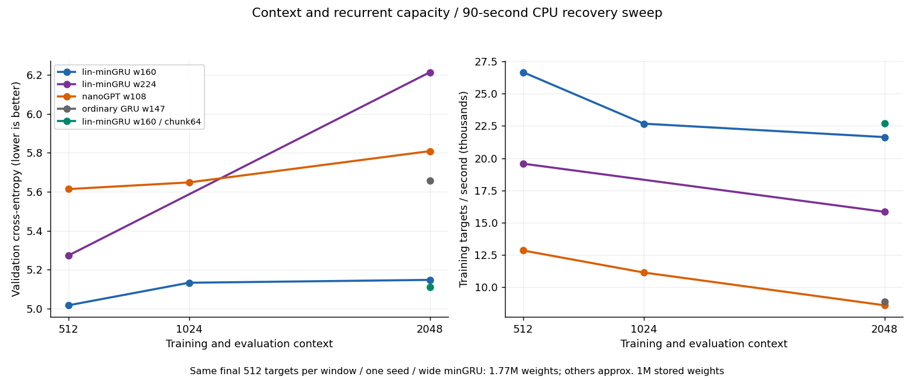
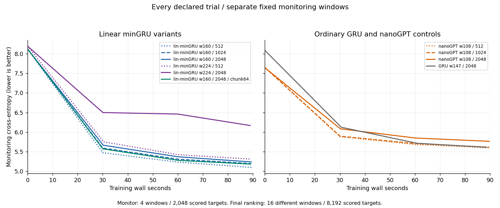

# Context length and recurrent capacity: recovered CPU screen

**10 of 10 trials completed; 0 failed.** Best observed endpoint: **Linear minGRU w160, context 512, CE 5.016996**. Each declared recipe receives a 90-second training-wall allowance. Every final score uses the same final 512 targets from 16 validation windows (8,192 targets). One seed, descriptive exploration.

This fresh v2 follows an environment reset. The interrupted v1 result remains separate and is not included in the ranking. Exact data and pinned model sources were restored; source/protocol were published before training, and checkpoints were archived between trials. See [recovery details](../results/gru-context-capacity-20261016-v2/RECOVERY.md).

## Every endpoint

| Model | Context | Updates | Target exposures | Train wall s | CPU s | Final CE ↓ | PPL ↓ | Targets/s | Prefix benefit CE |
|---|---:|---:|---:|---:|---:|---:|---:|---:|---:|
| Linear minGRU w160 | 512 | 291 | 2,383,872 | 89.45 | 329.9 | 5.016996 | 150.96 | 26,651 | — |
| Linear minGRU w160 / chunk64 | 2048 | 247 | 2,023,424 | 89.16 | 333.2 | 5.110823 | 165.81 | 22,696 | +0.00521 |
| Linear minGRU w160 | 1024 | 247 | 2,023,424 | 89.25 | 331.8 | 5.132835 | 169.50 | 22,672 | +0.00448 |
| Linear minGRU w160 | 2048 | 236 | 1,933,312 | 89.38 | 336.0 | 5.147467 | 172.00 | 21,631 | +0.00616 |
| Linear minGRU w224 | 512 | 213 | 1,744,896 | 89.15 | 325.6 | 5.273071 | 195.01 | 19,573 | — |
| nanoGPT w108 | 512 | 563 | 1,153,024 | 89.72 | 357.5 | 5.613899 | 274.21 | 12,852 | — |
| nanoGPT w108 | 1024 | 488 | 999,424 | 89.64 | 357.1 | 5.648146 | 283.76 | 11,149 | +0.00744 |
| Ordinary GRU w147 | 2048 | 96 | 786,432 | 88.64 | 340.4 | 5.655868 | 285.96 | 8,873 | +0.00455 |
| nanoGPT w108 | 2048 | 377 | 772,096 | 89.68 | 356.6 | 5.808842 | 333.23 | 8,610 | +0.00612 |
| Linear minGRU w224 | 2048 | 172 | 1,409,024 | 88.92 | 330.6 | 6.214023 | 499.71 | 15,847 | -0.00035 |

Prefix benefit = CE after swapping history before the last 512 input tokens minus CE with authentic history. Positive means the authentic prefix helped this probe. Its first scored prediction is adjacent to the altered prefix, so the whole-suffix average mixes near and distant effects. Current suffix, targets and positions remain identical. The post-hoc PREFIX_PROFILE.json separates 64-token bins and the final prediction; only that final prediction isolates a prefix beyond the latest 512 inputs, and it has only 16 targets. This is not a retrieval benchmark.

## Declared contrasts

| Change | CE change ↓ | Perplexity change | Throughput ratio |
|---|---:|---:|---:|
| minGRU160:512 → 1024 | +0.11584 | +12.28% | 0.851× |
| minGRU160:512 → 2048 | +0.13047 | +13.94% | 0.812× |
| nanoGPT:512 → 1024 | +0.03425 | +3.48% | 0.867× |
| nanoGPT:512 → 2048 | +0.19494 | +21.52% | 0.670× |
| Width 160 → 224 at 512 | +0.25607 | +29.18% | 0.734× |
| Width 160 → 224 at 2048 | +1.06656 | +190.54% | 0.733× |
| Chunk32 → 64 at 2048 | -0.03664 | -3.60% | 1.049× |
| Ordinary GRU → minGRU160 at 2048 | -0.50840 | -39.85% | 2.438× |

## Observations

- Longer context did not pay back its time cost for the small minGRU in this screen: 512 → 2,048 changes CE by +0.1305 and throughput by -18.8%. Both lengths score the identical target tails, but longer sequences have fewer resets and different optimization dynamics.
- The 64-token chunk at 2K improves CE by 0.0366 and throughput by 4.9% relative to chunk32. This CE gap is below the declared 0.05 follow-up signal and combines scan size with slower feedback clocks.
- At 2K, the small chunk32 minGRU reaches CE 5.1475, ordinary GRU 5.6559, and nanoGPT 5.8088. Its throughput is 2.44× ordinary GRU and 2.51× nanoGPT on this CPU implementation.
- Widening minGRU changes CE by +0.2561 at 512 and +1.0666 at 2K. That is a result for the shared short-run recipe, not evidence that larger state cannot help after longer training or tuning.
- The earlier 180-second results use a different horizon, seed, data order and evaluation windows. Their lower absolute CE values are not a regression comparison with this screen.

These are paired configurations within one seed, not uncertainty estimates. CE differences of 0.05 were declared useful leads for follow-up; they do not establish confirmation. A wall-time comparison permits different update and target counts.

Curves score four separate monitoring windows (2,048 targets), so their endpoints differ from the final table. Every declared final checkpoint is reported; no best-checkpoint selection.

## Position-specific prefix diagnostic

This post-hoc view is descriptive. Each 64-target bin contains 1,024 losses; the last-target column contains only 16. Values are swapped-prefix CE minus authentic-prefix CE. The first bin is close to the changed history; only the final prediction guarantees the entire changed prefix lies beyond its latest 512 inputs.

| Model | Context | First 64 suffix targets | Last 64 suffix targets | Final target only |
|---|---:|---:|---:|---:|
| Linear minGRU w160 / chunk64 | 2048 | +0.024270 | +0.001465 | -0.008870 |
| Linear minGRU w160 | 1024 | +0.026451 | +0.000641 | -0.003980 |
| Linear minGRU w160 | 2048 | +0.029165 | -0.000822 | -0.005765 |
| nanoGPT w108 | 1024 | +0.018759 | +0.001822 | -0.022808 |
| Ordinary GRU w147 | 2048 | +0.022284 | +0.000597 | -0.006316 |
| nanoGPT w108 | 2048 | +0.005975 | +0.009690 | -0.007476 |
| Linear minGRU w224 | 2048 | -0.000174 | -0.000264 | +0.005757 |

Eleven of the 16 final windows contain no EOS in their latest 512 inputs. The other five end within 512 inputs of an EOS. This composition check uses existing windows and does not create a new test split. Prefix swapping also changes the distribution of history, so these differences do not establish retrieval competence.

For the small recurrent models, most of the positive whole-suffix effect occurs in the first 128 targets. Their last 64-target bins are close to zero, and their final-target estimates are negative. With only 16 final-target observations, this gives no convincing evidence of a useful distant-prefix benefit; it does not prove the state contains no distant information. The nanoGPT 2K profile is more distributed, but its tiny final-target estimate is also inconclusive.

All six fixed-prompt sample continuations are retained. They contain word fragments and occasional local phrases but are not coherent answers. The loss ranking should not be mistaken for usable generation quality.

## Implementation and limits

- Exact preserved FineWeb-Edu uint16 arrays, train-only 2048-BPE tokenizer, seed 101605/data-order 101614. Reused validation; no official test access.
- All lengths tile the same ordered 2048-target training blocks. Recurrent arms use 8,192 targets/update (batch 16/8/4 at context 512/1024/2048); nanoGPT uses 2,048 (batch 4/2/1). Same ordered target content at a matched consumed-block count, but faster runs consume more blocks.
- Full BPTT and a fresh recurrent state for each example; EOS is a learned token and does not reset state mid-example. Longer context also means fewer independent reset sequences per update. This is not a persistent-lane streaming training test.
- AdamW 0.9/0.95, epsilon 1e-8, clip 1, decay 0.1 for matrices except 2048-row embedding tables. **Both nanoGPT token and position tables receive zero decay.** V2 explicitly records the inherited helper behavior that v1 prose omitted. Peak LR 0.008 for recurrent arms, 0.002 for nanoGPT; 5% wall warmup and cosine to 10%. One recipe per arm, not an exhaustive tuning comparison.
- Linear minGRU retains input-only gates, signed linear candidates, an unfused affine scan inside each feedback chunk, and nonlinear segment/document GRUs. Native and chunk32 linear arms keep the same 32/8 hierarchy timing. Chunk64 changes segment feedback AND document period 256 → 512 tokens; its result cannot isolate scan speed from memory timescales.
- Width 160 → 224 increases persistent FP32 sequence state from 2,560 to 3,584 bytes (+40%), while parameters rise 996,320 → 1,767,584 (+77.4%). All hidden projections/readout also widen. This does not isolate state capacity at fixed weights or compute.
- Ordinary GRU has 995,925 parameters and 2,352 persistent FP32 state bytes per sequence. These state counts exclude model weights, training activations, workspaces and allocator overhead; they are not total-memory measurements.
- All nanoGPT arms have 1,008,072 stored parameters, width 108, four layers/heads and a fixed 2048-position table. At context 512/1024/2048, respectively 842,184/897,480/1,008,072 parameters are reached; unused position rows still count toward stored parameters. This choice fixes the architecture across length arms. The inherited startup log excludes position embeddings and prints 0.79M; the table counts all stored parameters. Every primary evaluation uses its training length; no learned-position extrapolation.
- Four CPU threads; sequential workers. Training clock includes sampling through AdamW, excludes monitoring/checkpoint IO. Aggregate CPU, launcher latency and peak process RSS are retained; RSS is not a deployment-memory comparison. No GPU speed claim follows.
- Recovery repeats the interrupted seed/configurations on a restored runtime. Prior console-only results are not pooled, and cross-study differences do not isolate a single cause.

## Checks and artifacts

Preflight verifies identical training target content across lengths, identical scored validation tails, finite forward/backward/AdamW, and 2K state carry through a nonboundary split. Post-run analysis reconciles every target count, LR and clock and replays final/prefix-swap window losses from saved checkpoints. All replay differences are exactly zero on this runtime. Two truncated backup archives were detected after successful upload receipts; both were rebuilt byte-for-byte from intact checkpoints and replaced, with repair provenance retained.

- [Protocol](../results/gru-context-capacity-20261016-v2/PROTOCOL.json), [registration](../results/gru-context-capacity-20261016-v2/REGISTRATION.json), [summary](../results/gru-context-capacity-20261016-v2/SUMMARY.json), [checks](../results/gru-context-capacity-20261016-v2/CHECKS.json), [terminal](../results/gru-context-capacity-20261016-v2/TERMINAL.json).
- [Source/runner](../results/gru-context-capacity-20261016-v2/experiment.py), [launcher](../results/gru-context-capacity-20261016-v2/launch.py), [analysis](../results/gru-context-capacity-20261016-v2/analyze.py), [report generator](../results/gru-context-capacity-20261016-v2/report.py).
- [Checkpoint hashes](../results/gru-context-capacity-20261016-v2/CHECKPOINT_MANIFEST.json), [archive preservation](../results/gru-context-capacity-20261016-v2/CHECKPOINT_ARCHIVES.json), [repair provenance](../results/gru-context-capacity-20261016-v2/ARCHIVE_REPAIRS.json), [unfiltered samples](../results/gru-context-capacity-20261016-v2/SAMPLES.json). Large weights/AdamW/RNG/full traces are in contributor-held checkpoint archives, outside Git.

- [Position-specific prefix profile](../results/gru-context-capacity-20261016-v2/PREFIX_PROFILE.json), [document-boundary composition](../results/gru-context-capacity-20261016-v2/DATA_CONTEXT.json).

## Next small experiment

Test state carry between 512-token training chunks with detached gradients, matched contiguous data, and explicit document-boundary behavior, beside a reset-state control. This could expose longer history while retaining short backpropagation chunks. A four-token causal input mixer is a separate cheap variant to sample. These are proposed follow-ups, not implemented or queued; no larger model or GPU allocation is needed to ask the next question.

Every declared failure is retained in SUMMARY.json. No automatic promotion, upstream submission or merge is requested.
