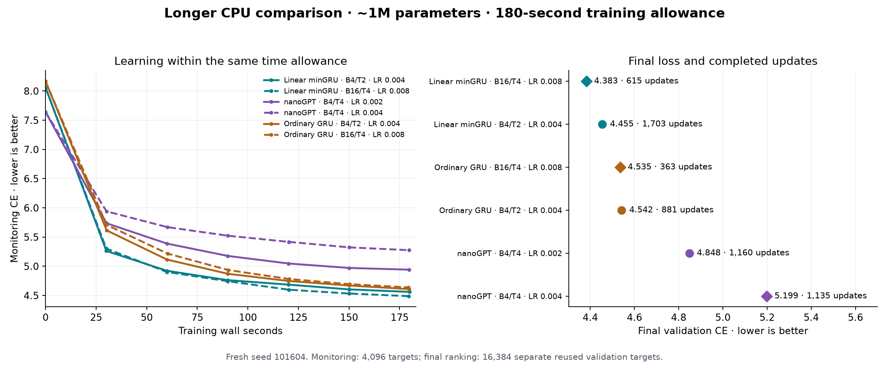
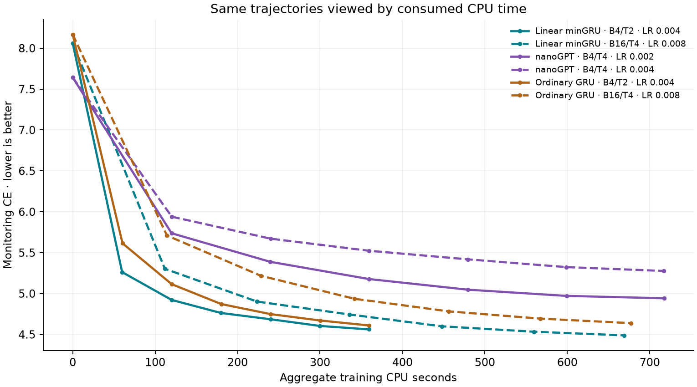

# Longer wall-time comparison: minGRU, ordinary GRU and nanoGPT

**Best measured endpoint: Linear minGRU · B16/T4 · LR 0.008, CE 4.382792.** Six fresh recipes each receive a 180-second training-wall allowance, extending the previous 60-second exploration. This is a practical recipe comparison with two choices per architecture. It does not establish the best possible recipe for any architecture.

This contribution updates the existing draft PR in **JRowe47/Super-1 → main**. No upstream submission or automatic merge is requested.

## Results

| Model | Batch / threads | Peak LR | Updates | Target exposures | Training wall s | Training CPU s | Final CE ↓ |
|---|---:|---:|---:|---:|---:|---:|---:|
| Linear minGRU | 16 / 4 | 0.008 | 615 | 5,038,080 | 179.43 | 668.9 | 4.382792 |
| Linear minGRU | 4 / 2 | 0.004 | 1,703 | 3,487,744 | 179.82 | 359.2 | 4.454564 |
| Ordinary GRU | 16 / 4 | 0.008 | 363 | 2,973,696 | 179.34 | 677.2 | 4.534900 |
| Ordinary GRU | 4 / 2 | 0.004 | 881 | 1,804,288 | 179.66 | 359.3 | 4.541924 |
| nanoGPT | 4 / 4 | 0.002 | 1,160 | 2,375,680 | 179.72 | 717.5 | 4.848029 |
| nanoGPT | 4 / 4 | 0.004 | 1,135 | 2,324,480 | 179.69 | 717.1 | 5.199139 |

Parameter counts: ordinary GRU 995,925; linear minGRU 996,320; nanoGPT 1,004,880 including position embeddings. nanoGPT's constructor log prints0.94M because its default display excludes the position table; the counts here include every trainable parameter. All rows use seed 101604, data-order seed 101613, FP32, context 512, and the same final 32-window / 16,384-target region. The validation region has been repeatedly used in this project. No declared trial failed.



Curves use a separate fixed eight-window / 4,096-target monitoring region. The final table and right panel use the larger final region, so curve endpoints and final ranking losses are different measurements. Every declared recipe is shown, using the final checkpoint rather than a validation-selected checkpoint.

## Planned comparisons

- **Linear minGRU · B4/T2 · LR 0.004 versus Ordinary GRU · B4/T2 · LR 0.004:** CE -0.0874, perplexity -8.4%; 1.93× target throughput, 1.93× updates and 1.00× aggregate CPU time.
- **Linear minGRU · B16/T4 · LR 0.008 versus Ordinary GRU · B16/T4 · LR 0.008:** CE -0.1521, perplexity -14.1%; 1.69× target throughput, 1.69× updates and 0.99× aggregate CPU time.
- **nanoGPT · B4/T4 · LR 0.004 versus nanoGPT · B4/T4 · LR 0.002:** CE +0.3511, perplexity +42.1%; 0.98× target throughput, 0.98× updates and 1.00× aggregate CPU time.

Best endpoint among the two declared recipes in each family:

- **Ordinary GRU:** Ordinary GRU · B16/T4 · LR 0.008, CE 4.534900.
- **Linear minGRU:** Linear minGRU · B16/T4 · LR 0.008, CE 4.382792.
- **nanoGPT:** nanoGPT · B4/T4 · LR 0.002, CE 4.848029.

The resource trade-offs between the two GRU recipes are:

- **Ordinary GRU:** switching from B4/T2/LR 0.004 to B16/T4/LR 0.008 changes final CE by -0.0070, while consuming 1.88× aggregate CPU time and processing 1.65× targets.
- **Linear minGRU:** switching from B4/T2/LR 0.004 to B16/T4/LR 0.008 changes final CE by -0.0718, while consuming 1.86× aggregate CPU time and processing 1.44× targets.

Tiny endpoint differences should be read as close results in a single-seed screen, rather than reliable separation. The exact ranking and the resource cost are both retained.

The two GRU-family comparisons match batch, threads and peak learning rate between architectures. At a fixed elapsed allowance, their cheaper or slower updates produce different data exposure and optimizer-step counts. The nanoGPT pair holds batch and threads fixed and changes peak LR. Within either GRU family, B4/T2/LR 0.004 versus B16/T4/LR 0.008 changes three settings together; it cannot isolate any one setting's causal effect.



CPU time is the process's aggregate CPU consumption across its threads. More threads can spend more CPU seconds inside the same wall allowance. This second plot re-expresses the recorded trajectories; it is not a separate equal-CPU training experiment, and each recipe's LR still follows its original wall-time schedule. Neither clock is a direct FLOP measurement.

## Why these six recipes

The preceding [minGRU thread/LR screen](mingru-thread-lr-20261016-v1.md) favored B4/T2/LR 0.004, followed by B16/T4/LR 0.008. Those two recipes are carried forward and also applied to ordinary GRU, giving matched configuration comparisons. nanoGPT keeps its previously measured B4/T4 throughput setting and receives peak LR 0.002 and 0.004. These are two plausible choices per family, not equal or exhaustive hyperparameter optimization; the GRU choices are informed by minGRU's prior results.

This pass uses a new initialization seed and a new common training-window stream. Its final losses therefore cannot be compared with the previous study as an isolated effect of extending time. The 180-second cosine schedule also has a nine-second warmup; a checkpoint around 60 seconds is not equivalent to a completed 60-second run.

## Data, implementation and timing

- The exact FineWeb-Edu uint16 arrays and train-only 2048-BPE tokenizer are unchanged and hash-checked. Examples use 512 next-token targets with a reset state and full BPTT. Consecutive entries in the common random-window stream are regrouped into batches; the number of consumed entries depends on runtime speed. Official test data is untouched.
- The existing model implementations are reused without architecture changes. Linear minGRU retains the signed linear candidate, input-only gate and 32-token affine scan, plus the same segment/document GRUs. Ordinary GRU uses the same hierarchy. nanoGPT uses the corrected wrapper that consumes its returned CE once; the old duplicated CE overhead is absent.
- AdamW betas 0.9/0.95, epsilon 1e-8, weight decay 0.1 with existing exclusions, gradient norm clip 1. The declared peak LR has 5% training-wall warmup (factor floor 0.04) then cosine decay to 10% of peak over 180 seconds. No adaptive LR search or validation-dependent stopping.
- Every run starts fresh. Workers execute sequentially on the existing CPU host, pinned to CPUs 0–1 for two threads or 0–3 for four threads, with one interop thread and deterministic PyTorch algorithms. Other host activity is uncontrolled. No GPU or new paid resources.
- The training timer covers batch construction, forward, CE, backward, clipping and AdamW. It excludes setup, monitoring and checkpoint IO. `run_wall_seconds` / `run_cpu_seconds` cover initial monitoring through final evaluation, including checkpoint IO. Separate setup timers start before Torch import; `LAUNCH_RESULT.json` additionally records end-to-end worker wall time from before process creation through exit. This clarifies the previous harness's overly broad “full-run” wording.
- Stopping uses a reserve of max(0.2 seconds, twice the largest recent update). Actual training times appear in the table; the initial estimate uses the earlier benchmark for that configuration. A failure is retained and reported without replacement. Per-process CPU and wall caps were raised to accommodate the longer run before training began.

## Checks and replay

Checkpoint evaluation reproduces every saved final-window loss within 5e-6. The analysis reconciles source/data/tokenizer hashes, the new stream digest, parameter counts, every learning rate, update and target counts, finite training values, accumulated wall/CPU times, stopping margins and launcher timing. Existing parent logits/gradient parity checks cover the unchanged model implementation; that grid is not repeated here.

- [Protocol](../results/gru-longer-wall-20261016-v1/PROTOCOL.json), [registration](../results/gru-longer-wall-20261016-v1/REGISTRATION.json), [summary](../results/gru-longer-wall-20261016-v1/SUMMARY.json), [checks](../results/gru-longer-wall-20261016-v1/CHECKS.json), [terminal state](../results/gru-longer-wall-20261016-v1/TERMINAL.json).
- [Runner](../results/gru-longer-wall-20261016-v1/experiment.py), [launcher](../results/gru-longer-wall-20261016-v1/launch.py), [analysis](../results/gru-longer-wall-20261016-v1/analyze.py), [report generator](../results/gru-longer-wall-20261016-v1/report.py). Keep the hash-bound sibling batch/thread study and original GRU implementation directories together.
- Final model/AdamW/RNG/full traces: `gru_longer_wall_checkpoints_20261016.zip`. Exact data remains in `gru_extended_checkpoints_20261016.zip`, SHA256 c90bb924b3b69e49bf217582776e7add78292d8c72e8a2fa5e82bd28a6db80a6. These contributor-held payloads remain outside Git; see [preservation metadata](../results/gru-longer-wall-20261016-v1/PRESERVATION.json).

```bash
python auto-research/results/gru-longer-wall-20261016-v1/report.py
# Training replay: separate copy/output directory, retaining frozen protocol and dependencies,
# with no completed execution artifacts. Preserve this published run.
python auto-research/results/gru-longer-wall-20261016-v1/launch.py --data-dir /path/to/exact/data
```

Time-based schedules depend on hardware speed, so a new training replay need not follow the identical trajectory. The exact saved-checkpoint evaluation and complete compressed traces provide the record of what ran. These single-seed, small-model CPU observations guide the next experiment; they are not an official nanoGPT GPU speedrun or a large-model scaling result.
