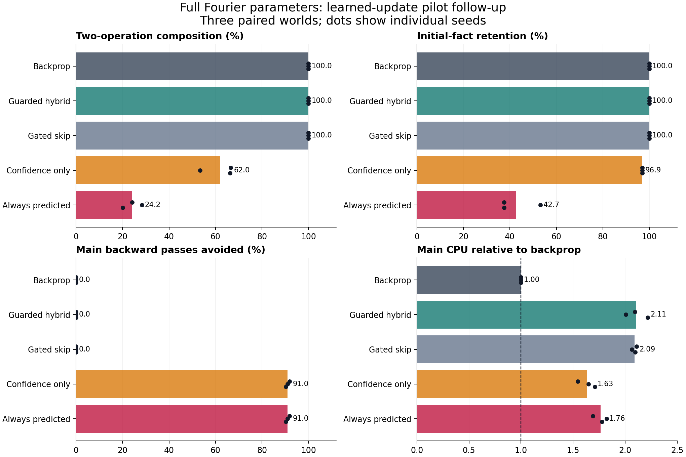

# First full-Fourier / hybrid-update experiment

The complete Fourier representation passed its frozen fidelity checks. The learned updater did **not** meet the registered success rule. The guarded hybrid used backprop on every main step, preserved baseline quality, and cost 2.11× as much CPU. Dropping the loss-support guard avoided 91.0% of main backward passes but reduced composition accuracy and still increased runtime. **Decision: no promotion.**

This is a deliberately narrow synthetic test of update prediction and qualification. It is not an LLM result or a test of the complete hierarchical-memory proposal.

## Design and scope

Two affine layers, 16→32→8 with tanh, contain 808 real parameters including biases. Each layer is represented by its **complete real orthonormal Fourier coordinates** (544 and 264). No frequencies are dropped, no smoothness regularizer is added, and no parameter family is removed. This establishes faithful coordinates in this model; it does not establish that FFTs make arbitrary dense layers cheaper or preserve all capabilities of an LLM.

Each seeded world contains eight random permutations of eight values. Warmup learns operators 0–3. Four main phases introduce operators 4–7, 250 steps each. Every batch of 64 contains 50% new-operator examples and 50% replay. Each arm sees the same 64,000 main examples, initial learner parameters and final evaluation inputs within its seed. SGD uses learning rate 0.5, with no momentum or weight decay.

An 898-parameter shared update network learns factors that assemble complete updates for both affine layers. Its inputs are forward activations, current output-layer weights, probabilities and observed target labels. True derivative factors supervise warmup but never enter predictor inputs. Predicted updates are norm-limited to 0.5. A 339-parameter gate predicts one-step acceptance, post-update query accuracy, and query loss change. It observes loss/entropy, norms, accuracy and two exponentially averaged audit-error summaries. The second summary measures disagreement between predicted and observed loss change—a limited operational version of dissonance. Post-update accuracy prediction is not a general calibrated state-uncertainty estimator; a separate learned surprise head is not implemented.

The learner, predictor and gate train together for 1,200 warmup steps. Calibration then uses 256 steps with the controller frozen and learner backprop active. The controller remains frozen during main evaluation to isolate transfer of update prediction. Ongoing controller training on fallback, token-context memory, multiple persistent memory timescales, learned hierarchy, variable depth and neural ODEs are deferred. The two audit EMAs are not a substitute for those components.

The pilot used seed 90917 and four arms. Inspection motivated one added diagnostic, confidence-only, before freezing the main protocol. The model, optimizer, tolerances and training lengths were unchanged. Main seeds 101721–101723 were fixed before execution. Registration was local, not an externally timestamped preregistration. Pilot evidence and its original source are preserved separately and excluded from main aggregates.

## Qualification and controls

A candidate passes a one-step query audit if its cross-entropy is at most 0.01 nats above the true SGD counterfactual on **both** a current-operator minibatch and an initial-operator minibatch. This labels tolerable effect, not exact gradient reconstruction or improvement over doing nothing. Queries are additional supervised computation and are included in measured cost; they are not free feedback or the final confirmation set.

Calibration selects the lowest of fixed thresholds 0.5/0.7/0.8/0.9/0.95/0.99 with at least 64 accepted examples and a one-sided Wilson lower bound ≥0.95. Temporally related samples make this a heuristic qualification, not an IID reliability guarantee. The guarded hybrid also requires training loss no larger than the maximum calibration loss. An independent 10% audit mask checks otherwise eligible steps.

- **Backprop:** ordinary learner SGD in the same complete Fourier coordinates.
- **Guarded hybrid:** confidence plus loss-support guard; sampled rejected audits fall back to SGD.
- **Gated skip:** identical predictor/gate cost, but an accepted step makes no update. It measures whether proposed edits add value over skipping.
- **Confidence only:** removes the loss-support guard, retaining confidence and audit fallback.
- **Always predicted:** applies every predicted update, even if a sampled audit rejects it. Audits are diagnostic and still charged.

Predicted main applications run without an autograd graph. Avoided backward passes count learner backward calls; they do not claim zero warmup training or zero supervision.

## Results

| Arm | Two-step accuracy | Four-step accuracy | Old facts | New facts | Backward passes avoided | Main CPU / baseline | Lifecycle CPU / baseline |
|---|---:|---:|---:|---:|---:|---:|---:|
| Backprop | 100.00% | 100.00% | 100.00% | 100.00% | 0.00% | 1.00× | 1.00× |
| Guarded hybrid | 100.00% | 100.00% | 100.00% | 100.00% | 0.00% | 2.11× | 3.45× |
| Gated skip | 100.00% | 100.00% | 100.00% | 100.00% | 0.00% | 2.09× | 3.45× |
| Confidence only | 62.04% | 41.00% | 96.88% | 59.38% | 91.03% | 1.63× | 3.24× |
| Always predicted | 24.22% | 14.06% | 42.71% | 45.83% | 91.03% | 1.76× | 3.30× |

Ratios are the mean of paired per-seed CPU ratios. Main CPU covers data generation, prediction, gating, audits, learner updates and progress collection. It excludes post-run checkpoint serialization and final confirmation. Lifecycle CPU adds the appropriate measured warmup: plain learner warmup for backprop, joint controller warmup for the other arms. Both startup paths produce exactly equal learner coefficients. Timing is descriptive: one thread per worker, three concurrent seed workers, fixed arm order, CPU only. The tiny learner makes controller overhead especially visible; these ratios do not predict GPU/LLM scaling.

The guarded hybrid and gated-skip control had **zero eligible steps**, so both exactly match backprop's final metrics. They demonstrate fallback protection, not successful forward-only learning. Their zero acceptance also leaves the value of accepted updates versus no-op untested. The confidence-only arm retained 96.875% of initial facts but learned only 59.375% of new facts on average. Failures compound when those facts are chained. Always-predicted updates also substantially damaged old knowledge.

Confirmation scores all 64 atomic facts, all 512 two-operation combinations, and 2,048 seeded four-operation chains. Atomic facts overlap training by design; composed chains receive no training loss. A fixed external executor supplies the operation order. The model does not learn a parser, discover a semantic graph or choose its own reasoning depth. Baseline composition reaches a ceiling, so equal scores are not evidence of a quality improvement.

## Confidence failed under the curriculum shift

| Seed | Calibration pass | Mean calibration confidence | Relative update error | Loss support cap | Shifted audit pass | Mean shifted confidence |
|---|---:|---:|---:|---:|---:|---:|
| 101721 | 256/256 | 99.629% | 1.153 | 0.009028 | 18/81 | 99.660% |
| 101722 | 256/256 | 99.663% | 1.025 | 0.008682 | 45/91 | 99.673% |
| 101723 | 256/256 | 99.671% | 1.232 | 0.008623 | 37/97 | 99.702% |

Across the confidence-only audits, mean predicted acceptance was **99.680%**, while only **100/269 (37.17%)** met the registered one-step test. These are sampled audits across dependent trajectories, not an independent-binomial estimate.

All 256 calibration candidates passed in each seed, even though mean relative parameter-update error was roughly 1.0–1.2. Calibration took place near convergence, where a 0.01-nat tolerance can admit very inaccurate or nearly inert updates. That success did not predict ability to learn new operators. The loss-support guard correctly rejected the shifted regime, but it rejected every main step. Confidence alone did not detect the mismatch. A 10% fallback audit can replace a current bad proposal; it cannot undo accumulated unaudited errors.

This supports a concrete next hypothesis: train and calibrate over full learning trajectories and task changes, including confident mistakes and substantial beneficial updates; require measured usefulness versus no-op as well as retention relative to SGD. Compare a frozen controller with one that continues teacher training on fallback. These are follow-up proposals, not results of this run.

## Registered decision and integrity

The primary guarded-hybrid comparison had to stay within 2 percentage points of baseline composition and 1 point of old-fact retention in every seed, avoid at least 25% of main backward passes on average, and reduce mean main CPU by at least 10%. Added value over gated skip required a 2-point composition gain or 0.02-nat new-fact CE reduction. Quality limits passed; backward savings, CPU savings and added-value criteria failed. No thresholds were changed after main results.

Original FP32 absolute tolerance was 2e-6 and FP64 tolerance 2e-12. Checks covered odd/even FFT roundtrips, norm preservation, dense/curve forward outputs, input and parameter gradients, and one SGD update. Maximum FP32 roundtrip error was 7.153e-7; maximum parameter-gradient error 3.726e-8; maximum one-step weight error 1.491e-7. Teacher-factor assembly agreed with autograd to 6.520e-9. Nonzero predicted updates were also verified to change parameters with autograd disabled. All checks passed the original thresholds without relaxation.

All 18 main checkpoints (warmup plus five arms per seed) were hashed before confirmation. All 15 final checkpoints were reloaded and scored twice with identical metrics. This establishes reproducibility, not additional independent evidence. All main workers exited successfully, using 46.526 total process CPU seconds; the launcher took 17.214 wall seconds. Three seeds support descriptive paired results, not broad statistical or architectural claims.

A post-main diagnostic, `COMPUTE_DIAGNOSTIC.json`, compares dense and Fourier forward/backward, proposed SGD updates **and dense materialization of the updated curve**. Median curve/dense times at batches 1/64/256 were 0.550/0.181, 0.583/0.214 and 0.660/0.292 ms. This includes an extra re-export and is not the main training-step measurement. It shows no speed advantage for this unoptimized small-model route. No wavelet, sparse-band, basis-layout or variable-depth speedup was tested. Frequency in a flattened parameter vector should not be interpreted as semantic abstraction without separate evidence.

## Per-seed evidence

| Seed | Arm | Two-step | Four-step | Old facts | New-fact CE | Main CPU (s) | Backward passes | Predicted updates applied |
|---|---|---:|---:|---:|---:|---:|---:|---:|
| 101721 | backprop | 100.00% | 100.00% | 100.00% | 0.03971 | 0.951356 | 1000 | 0 |
| 101721 | hybrid | 100.00% | 100.00% | 100.00% | 0.03971 | 1.991949 | 1000 | 0 |
| 101721 | gated_skip | 100.00% | 100.00% | 100.00% | 0.03971 | 2.007953 | 1000 | 0 |
| 101721 | confidence_only | 66.60% | 46.04% | 96.88% | 0.87991 | 1.467978 | 81 | 937 |
| 101721 | always_hyper | 24.22% | 14.99% | 37.50% | 1.39462 | 1.607926 | 81 | 1000 |
| 101722 | backprop | 100.00% | 100.00% | 100.00% | 0.04145 | 0.939993 | 1000 | 0 |
| 101722 | hybrid | 100.00% | 100.00% | 100.00% | 0.04145 | 1.883986 | 1000 | 0 |
| 101722 | gated_skip | 100.00% | 100.00% | 100.00% | 0.04145 | 1.939985 | 1000 | 0 |
| 101722 | confidence_only | 53.32% | 31.49% | 96.88% | 1.00543 | 1.548019 | 91 | 954 |
| 101722 | always_hyper | 28.32% | 14.70% | 53.12% | 1.58934 | 1.711994 | 91 | 1000 |
| 101723 | backprop | 100.00% | 100.00% | 100.00% | 0.04022 | 0.933557 | 1000 | 0 |
| 101723 | hybrid | 100.00% | 100.00% | 100.00% | 0.04022 | 2.069831 | 1000 | 0 |
| 101723 | gated_skip | 100.00% | 100.00% | 100.00% | 0.04022 | 1.958128 | 1000 | 0 |
| 101723 | confidence_only | 66.21% | 45.46% | 96.88% | 0.81487 | 1.594475 | 97 | 940 |
| 101723 | always_hyper | 20.12% | 12.50% | 37.50% | 1.53860 | 1.659126 | 97 | 1000 |

Source, frozen protocols, calibration/audit traces, all scores and terminal receipts are in `auto-research/results/hybrid-curve-updates-20261017-v1/`. The checkpoint companion contains the five pilot and eighteen main snapshots, with checksums; extract it into that result directory for evaluation replay. See that directory's `README.md` and `PRESERVATION.json`. Earlier curve/minLSTM studies and their caveats remain separate and unchanged.
