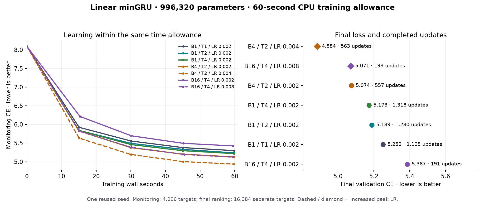

# minGRU: small batches, threads and learning rate

**Best measured endpoint: B4 / T2 / LR 0.004, CE 4.884254.** The fresh B1/T1/LR0.002 reference reaches CE 5.251620. The winning configuration changes perplexity by -30.7% versus that reference within the same 60-second training-wall allowance. This is a seven-trial explorer screen with one reused seed, not a tuned optimum or a seed replication.

Research PR target: **JRowe47/Super-1 → main**, using the existing draft PR. Upstream submission requires the user's explicit go-ahead.

## Results

| Batch / threads | Peak LR | Updates | Target exposures | Training wall s | Training CPU s | Final CE ↓ |
|---|---:|---:|---:|---:|---:|---:|
| 4 / 2 | 0.004 | 563 | 1,153,024 | 59.80 | 119.6 | 4.884254 |
| 16 / 4 | 0.008 | 193 | 1,581,056 | 59.41 | 220.4 | 5.071071 |
| 4 / 2 | 0.002 | 557 | 1,140,736 | 59.87 | 119.6 | 5.074294 |
| 1 / 4 | 0.002 | 1,318 | 674,816 | 59.81 | 239.0 | 5.172636 |
| 1 / 2 | 0.002 | 1,280 | 655,360 | 59.82 | 119.6 | 5.189115 |
| 1 / 1 | 0.002 | 1,105 | 565,760 | 59.83 | 59.8 | 5.251620 |
| 16 / 4 | 0.002 | 191 | 1,564,672 | 59.43 | 220.2 | 5.386708 |

All rows use the unchanged 996,320-parameter linear minGRU hierarchy, initialization seed 101603, data-order seed 101612, and the same fixed 32-window / 16,384-target final validation region as the preceding study. Validation has been repeatedly viewed; it is not an untouched test. No declared trial failed.



The learning curves use a separate eight-window / 4,096-target monitoring region. Table and right-panel endpoints use the larger final region. A curve endpoint and its table loss are therefore different measurements. All declared trials are reported; no best-checkpoint selection.

## Planned contrasts

- **B1 / T2 / LR 0.002 vs B1 / T1 / LR 0.002:** CE -0.0625; perplexity -6.1%; 1.16× target throughput, 1.16× optimizer updates, 2.00× aggregate training CPU time.
- **B1 / T4 / LR 0.002 vs B1 / T1 / LR 0.002:** CE -0.0790; perplexity -7.6%; 1.19× target throughput, 1.19× optimizer updates, 3.99× aggregate training CPU time.
- **B4 / T2 / LR 0.004 vs B4 / T2 / LR 0.002:** CE -0.1900; perplexity -17.3%; 1.01× target throughput, 1.01× optimizer updates, 1.00× aggregate training CPU time.
- **B16 / T4 / LR 0.008 vs B16 / T4 / LR 0.002:** CE -0.3156; perplexity -27.1%; 1.01× target throughput, 1.01× optimizer updates, 1.00× aggregate training CPU time.

These comparisons isolate the declared setting changes within a common implementation and time allowance, but different runtime speeds also change the number of updates and consumed windows. They do not separately identify data efficiency, optimizer-step efficiency or a mathematical scaling law.

Fresh controls compared with the preceding batch/thread study:

- B1 / T1 / LR 0.002: previous CE 5.2647, fresh CE 5.2516; fresh/previous throughput 1.019×.
- B16 / T4 / LR 0.002: previous CE 5.3927, fresh CE 5.3867; fresh/previous throughput 1.011×.

Use the fresh within-study controls for the main comparisons. The two reruns help expose timing drift but do not estimate seed variance. Ordinary GRU and nanoGPT were not retrained in this pass, so the new ranking is among minGRU configurations only. The preceding [batch/thread report](gru-batch-wall-20261016-v1.md) contains the architecture comparisons.

## What was held fixed

- **Data:** exact hash-bound uint16 arrays and train-only 2048-BPE tokenizer from the preceding study. Each example predicts the next token over a reset 512-token window with full BPTT. Each batch takes the next B consecutive windows of the same frozen stream. Batch size changes grouping, exposures per update and total exposures within the clock.
- **Model:** signed linear candidate and input-only gate, affine scan within 32-token chunks, with the same segment/document GRUs and readout. No new recurrent, attention or scan implementation. The existing parent logits/gradient parity checks remain applicable; this pass changes configuration and schedule only.
- **Optimizer:** AdamW betas 0.9/0.95, epsilon 1e-8, weight decay 0.1 with the same exclusions, global gradient clip 1. Peak LR is declared per row. Warmup occupies 5% of measured training time with initial factor floor 0.04; cosine decay then reaches 10% of the peak at 60 seconds. The 2× and 4× LR choices are quick trials, not a claimed Adam batch-scaling rule.
- **Execution:** one worker at a time; thread 1 pinned to CPU0, thread 2 to CPUs0–1, thread 4 to CPUs0–3. CPU FP32, deterministic PyTorch algorithms, one interop thread. Training time includes data construction, forward, CE, backward, clipping and AdamW. Startup, evaluation and checkpoint IO are outside this clock. Separate `run_wall_seconds` / `run_cpu_seconds` fields cover initial monitoring through final evaluation, including checkpoint IO; they exclude process startup, data verification and model/optimizer construction. The inherited protocol phrase “full-run” is broader than these actual fields: they are not end-to-end launcher latency. Equal wall allowance with more threads consumes more aggregate CPU, as shown above; it is not equal compute.
- **Stopping:** stop before the next update when remaining time is at most max(0.2 seconds, twice the largest of the last ten updates). Actual training times are shown. Validation does not affect stopping. The initial estimate reuses the preceding benchmark for that batch/thread cell; no benchmark weights are reused.
- **Ordering:** all seven fresh trials and their seeded shuffled order were frozen before training. Frozen source hashes bind the parent helpers and architecture. No new paid resources, GPU run or official-test evaluation.

## Checks and artifacts

Final checkpoints replay every final-window loss within 5e-6. The analysis reconciles data/tokenizer/source hashes, stream identity, parameter counts, all update and target counts, the learning rate at every step, accumulated wall/CPU time, finite losses/gradients and the stopping margin. Checkpoints retain model weights, AdamW state, Torch RNG and complete training traces. No extra model-parity grid was run because the forward/backward implementation is unchanged from the preceding checked study.

- [Frozen protocol](../results/mingru-thread-lr-20261016-v1/PROTOCOL.json), [registration](../results/mingru-thread-lr-20261016-v1/REGISTRATION.json), [summary](../results/mingru-thread-lr-20261016-v1/SUMMARY.json), [checks](../results/mingru-thread-lr-20261016-v1/CHECKS.json), [terminal state](../results/mingru-thread-lr-20261016-v1/TERMINAL.json).
- [Runner](../results/mingru-thread-lr-20261016-v1/experiment.py), [sequential launcher](../results/mingru-thread-lr-20261016-v1/launch.py), [analysis](../results/mingru-thread-lr-20261016-v1/analyze.py), [plot/report generator](../results/mingru-thread-lr-20261016-v1/report.py). The runner imports unchanged helpers from the preceding batch/thread study, which imports the original GRU model. Keep those sibling directories together.
- Checkpoint-only archive `mingru_thread_lr_checkpoints_20261016.zip`; exact arrays remain in `gru_extended_checkpoints_20261016.zip` (SHA256 c90bb924b3b69e49bf217582776e7add78292d8c72e8a2fa5e82bd28a6db80a6). These contributor-held payloads are outside Git. See [preservation metadata](../results/mingru-thread-lr-20261016-v1/PRESERVATION.json).

```bash
python auto-research/results/mingru-thread-lr-20261016-v1/report.py
# Training replay: separate copy/output directory, retaining frozen protocol and dependencies,
# with no completed execution artifacts. Do not overwrite the published run.
python auto-research/results/mingru-thread-lr-20261016-v1/launch.py --data-dir /path/to/exact/data
```

The time-based schedule depends on measured hardware speed, so a training replay need not reproduce the identical trajectory. Saved checkpoint evaluation is the exact replay check; complete observed traces are published as `curves.json.gz`.
