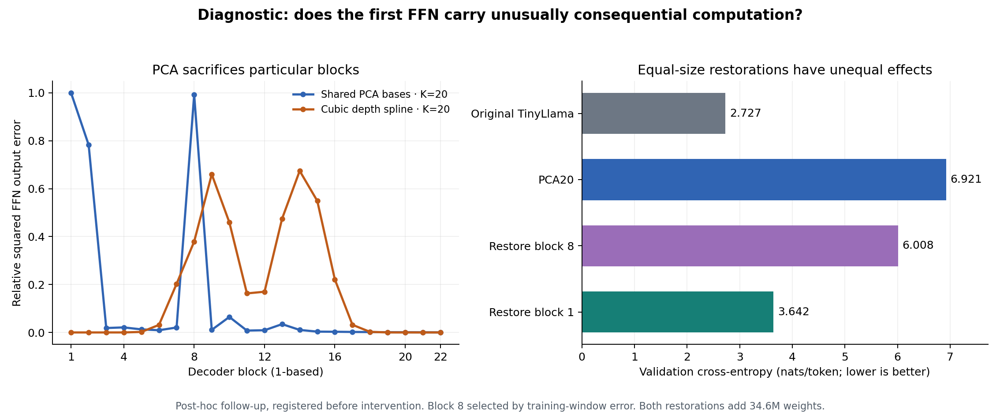

# TinyLlama: restoring a damaged FFN after depth compression

Status: **completed post-hoc diagnostic**, four of four arms. This follow-up was chosen after observing the complete [primary conversion screen](tinyllama-depth-curves-20261017-v1.md). It is not an independent confirmation. Its protocol was frozen before the restoration evaluations; SHA256 `111ed675ed3493003b116028afcdbc2843b343b36d9446828c09d0740250153b`.

## Question and equal-size control

The parent PCA20 fit gave nearly unit relative FFN output error at zero-based blocks0 and7, despite preserving more weight energy than the spline. Does the location of the damaged computation matter?

Keep the same PCA20 approximation and restore all three original FFN matrices in exactly one block. Compare block0 with block7, selected before intervention by the **largest parent training-window local error among nonzero blocks**. Each restoration adds exactly 34,603,008 weight scalars while retaining all shared bases and coefficients. This is an explicit original-layer exception, not a pure smooth curve. It does not create an extra executed layer.

## Results

Same pinned teacher, original 22-block execution, FP32 runtime, and repeated 2,048 validation targets as the parent. No training or tuning.

| Arm (0-based block identifiers) | Analytical total weight saving | CE ↓ (nats/token) | Forward KL ↓ | Teacher top-1 agreement ↑ |
|---|---:|---:|---:|---:|
| teacher | 0.00% | 2.727322 | 0.000000 | 100.00% |
| pca20_replay | 6.29% | 6.921142 | 4.164325 | 17.77% |
| pca20_restore_block7 | 3.15% | 6.008465 | 3.238689 | 27.93% |
| pca20_restore_block0 | 3.15% | 3.641893 | 0.902182 | 57.37% |

Plots use **1-based** block labels for readability; JSON/arm names use **0-based** indices. The first block is block0 / plot block1. The control is block7 / plot block8.

Restoring the first FFN improves CE by 3.279249 nats/token. Restoring the comparison FFN improves it by 0.912677. The first-block advantage is **2.366572 nats/token**. The predeclared diagnostic threshold was at least 1.0 nat/token; it **passed**.

The teacher and unrepaired PCA20 were rerun and reproduce every parent window CE exactly. The effect is therefore measured against freshly replayed controls, not a changed evaluation setup.

## Interpretation and limits

This tests the consequence of restoring two particular FFNs at equal stored-parameter cost. It does not establish a universal ranking of layer importance, a general causal explanation of the pretraining process, or a successful compressed deployment. Both blocks were selected after the parent run; selection used local training-window error, and validation is reused. Other alignments, activations, rank allocations and recovered-training configurations remain untested.

The result supports using function-sensitive preservation criteria when building a depth representation. A small global weight reconstruction error can hide a very damaging local change. The next bounded experiment should keep the first FFN exact and compare activation/output-aware basis fitting with the same storage-budget raw fit; neuron permutation alignment is a separate control.

## Execution and integrity

Four CPU threads, no GPU, zero optimizer updates. Total 98.6s wall / 359.2s process CPU, including loading, reconstruction and evaluation. Compact deployment memory and latency are unmeasured. All source, parent-result, projector and protocol bindings verified. All four arms completed, official test untouched, no paid resources or continued jobs.

[Source](../results/tinyllama-depth-anchor-20261017-v1/anchor_probe.py) · [Protocol](../results/tinyllama-depth-anchor-20261017-v1/PROTOCOL.json) · [Registration](../results/tinyllama-depth-anchor-20261017-v1/REGISTRATION.json) · [All results](../results/tinyllama-depth-anchor-20261017-v1/RESULTS.json) · [Checks](../results/tinyllama-depth-anchor-20261017-v1/CHECKS.json) · [Terminal receipt](../results/tinyllama-depth-anchor-20261017-v1/TERMINAL.json).
