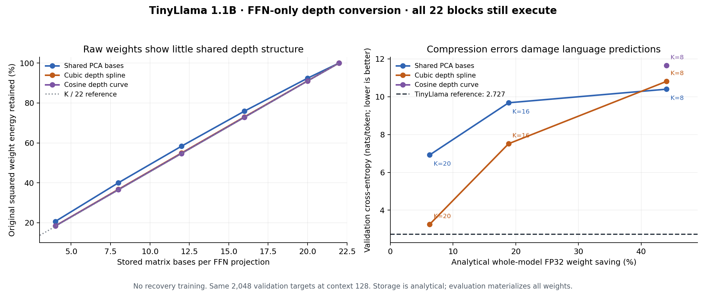

# TinyLlama: pretrained FFN weights as curves through depth

Status: **completed exploratory screen; the K=8 conversion gate failed**. All nine declared evaluations completed. No recovery training, architecture promotion, or independent confirmation is claimed.

The user authorized exploring the proposed TinyLlama FFN-only shared-basis/depth-curve conversion. Source and protocol were frozen locally before measurement; the initial protocol tree was published to JRowe47/Super-1 in commit `200efe83c8ff6dae81a7f2523e90a71f97701bcc`. Functional measurement began before that remote publication completed. Protocol SHA256: `24e381cad78233a466584097b087866805a6737953c6527e2657bd3135aac82f`.

## Question and controls

Can corresponding FFN weights of a pretrained 22-block language model be represented by far fewer shared matrix bases, with coefficients constrained to smooth functions of depth?

The checkpoint is public TinyLlama/TinyLlama-1.1B-intermediate-step-1431k-3T, revision `59f6f375b26bde864a6ca194a9a3044570490064`, safetensors SHA256 `9dc1c1a8c6b29e153dea7aaf2ed6c4d242163489add0e7c14c23889745437be4`. It has 1,100,048,384 parameters, including 761,266,176 in the three FFN projections across 22 blocks.

For each projection family, flatten corresponding matrices into X with 22 rows. Fit Xhat = Q Qᵀ X. PCA uses a constant depth mode and the leading K−1 directions of the centered layer Gram matrix. Splines use K uniformly spaced, clamped cubic B-spline controls. Cosines use K low-frequency DCT-II modes. All use K **full matrices** per family; this does not impose low matrix rank within a layer. Free PCA coefficient storage is counted separately. A rank22 spline is a reconstruction control. Sixty-four fixed random depth permutations provide a structural ordering control.

All attention, normalization, embeddings, output weights, residual connections, RoPE and execution depth remain the pretrained architecture. There is no recurrent conversion or variable-depth evaluation. No neuron/head alignment was performed; this is raw pretrained coordinate space.

## What actually ran

CPU FP32 inference, four threads; FP64 Gram matrices and depth fits. PyTorch 2.14.1+cpu, Transformers 4.57.6. The CPU identifies as AMD EPYC 9V74. Setup used an already available CPU PyTorch runtime and a separate environment for the remaining dependencies. No GPU or paid service was used.

Exact input hashes, pinned dataset revision, tokenizer identity and sampling positions are in [INPUTS.json](../results/tinyllama-depth-curves-20261017-v1/INPUTS.json) and [PROTOCOL.json](../results/tinyllama-depth-curves-20261017-v1/PROTOCOL.json). WikiText-2 raw **train and validation only** were downloaded. Sixteen fixed windows evenly span the tokenized validation stream; each has 128 inputs and 128 next-token targets, totaling 2,048 targets. Windows reset, may cross concatenated article boundaries, and provide at most 128-token history. Text joins nonempty raw lines with two newlines. These are TinyLlama-token metrics, not standard word-level WikiText perplexity.

Four train windows were frozen; only the first is used for the local FFN diagnostic in this pass. The first validation window supplies a second local diagnostic. All fits minimize weight error, without activation-based fitting, gradient updates, or distillation. Validation has been used elsewhere in the project and is not an untouched confirmation split. Pretraining contamination is unaudited.

## Results

| Arm | Matrix bases per projection | Analytical total weight saving | CE ↓ (nats/token) | Forward KL ↓ | Teacher top-1 agreement ↑ |
|---|---:|---:|---:|---:|---:|
| teacher | 22 | 0.00% | 2.727322 | 0.000000 | 100.00% |
| spline22_roundtrip | 22 | 0.00% | 2.727322 | 0.000000 | 100.00% |
| spline20 | 20 | 6.29% | 3.256099 | 0.495218 | 66.26% |
| spline8 | 8 | 44.04% | 10.806634 | 8.107037 | 0.00% |
| pca16 | 16 | 18.87% | 9.676859 | 6.877848 | 3.03% |
| pca20 | 20 | 6.29% | 6.921142 | 4.164325 | 17.77% |
| cosine8 | 8 | 44.04% | 11.647500 | 8.913061 | 0.00% |
| pca8 | 8 | 44.04% | 10.394838 | 7.618310 | 0.34% |
| spline16 | 16 | 18.87% | 7.513929 | 4.735668 | 10.11% |

The full-rank spline has exactly zero observed logit/CE drift in the declared reconstruction checks. The original teacher's repeated first window also has zero logit drift. Thus the poor compressed scores are not explained by the tested reconstruction or inference adapter.

At K=8, the primary gate required <=0.10 nats/token degradation from TinyLlama and <=0.05 nats/token spline disadvantage relative to PCA. Neither condition holds. The stored K=8 approximation would analytically remove about 44% of total weight scalars, but is not a useful converted model.

| Projection | Adjacent raw-weight cosine | PCA8 discarded energy | Spline8 discarded energy | Cosine8 discarded energy |
|---|---:|---:|---:|---:|
| gate_proj | 0.005500 | 58.67% | 63.18% | 63.18% |
| up_proj | -0.000050 | 60.44% | 63.14% | 63.53% |
| down_proj | -0.000116 | 61.28% | 63.53% | 63.71% |

The spectrum is relatively flat and natural ordering gives only small improvements over shuffled ordering in raw weight error; all shuffle ranges are retained in STRUCTURE.json. This does **not** establish that the model lacks functional redundancy, that all tensor factorizations fail, or that alignment/distillation cannot help.

At K=20, PCA minimizes the tested centered weight-space objective better than the spline, yet its language loss is much worse. Its depth projector gives the first block only roughly 0.056–0.064 diagonal self-contribution across the three projections. Its local train-window FFN output error is nearly 1.0 at block0 and block7. This motivated the separately registered, post-hoc [anchor diagnostic](tinyllama-depth-anchor-20261017-v1.md); those results are not pooled into the original gate.

Per-window CE values, changes and descriptive standard errors are retained in FUNCTIONAL.json and SUMMARY.json. There is one fixed pretrained model and no training-seed replication. Standard errors over these 16 selected windows are not population-level confidence bounds.

## Deployment and cost

The compact parameter counts are **analytical**: shared full matrix bases, small free PCA coefficients, and all unchanged non-FFN parameters. No compact checkpoint or optimized curve kernel was deployed. Functional evaluation materializes the reconstructed 22-layer weights, using the original checkpoint to compute them. Weight savings therefore do not describe the memory used by this experiment.

Structure measurement took 3.04s. Functional execution, including model loading, local diagnostics and reconstructions, took 261.9s wall / 949.4s process CPU. These are run costs, not prefill/decode or deployment-speed comparisons. Peak compact deployment RAM/VRAM, KV state, allocator reserve and p50/p95 latency are unmeasured. Recorded psutil RSS is implausible and excluded from conclusions; the OS-reported ru_maxrss high-water mark is 10,399,076 KiB for this materialized experiment.

## Decision and next experiment

**Do not promote an untrained raw-weight curve conversion.** The useful next question is how to preserve functionally important computation while learning a shared representation. The follow-up tests whether a small exact exception at the input end explains the PCA failure. Subsequent alternatives include function-preserving FFN neuron alignment and activation/output-aware fitting with explicit endpoint protection. Neither was tested in this primary screen.

## Integrity, artifacts and reproduction

- [Frozen source](../results/tinyllama-depth-curves-20261017-v1/experiment.py), [input acquisition](../results/tinyllama-depth-curves-20261017-v1/acquire.py), [source hashes](../results/tinyllama-depth-curves-20261017-v1/SOURCES.json), [registration](../results/tinyllama-depth-curves-20261017-v1/REGISTRATION.json).
- [All structural results](../results/tinyllama-depth-curves-20261017-v1/STRUCTURE.json), [exact depth projectors](../results/tinyllama-depth-curves-20261017-v1/PROJECTORS.json), [functional outcomes](../results/tinyllama-depth-curves-20261017-v1/FUNCTIONAL.json), [checks](../results/tinyllama-depth-curves-20261017-v1/CHECKS.json), [terminal receipt](../results/tinyllama-depth-curves-20261017-v1/TERMINAL.json).
- [Reproduction notes](../results/tinyllama-depth-curves-20261017-v1/README.md). Inputs are external public artifacts, recoverable by revision and verified SHA256. Large downloaded weights and corpus are not committed. No trained or transformed checkpoint requiring separate preservation was created.

All source/protocol/aggregate checks pass; nine of nine arms completed, zero failed arms. The official test was never downloaded or evaluated. No cloud resources, schedules, or follow-up jobs are running.
