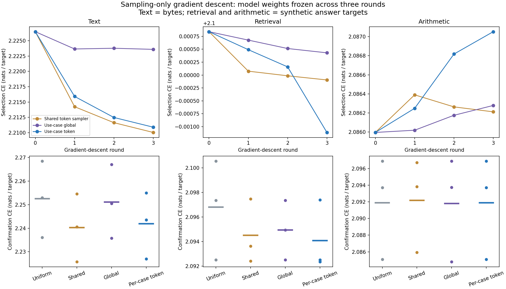

# Per-use-case sampling descent: usecase-sampling-descent-20261018-v1

Status: COMPLETED. Three paired seeds, three gradient-descent rounds, one final confirmation per selected checkpoint (with exact duplicates).

Observed outcome: text-specific tuning reduced confirmation CE from 2.252506 to 2.241863 nats/byte, but the shared sampler reached 2.240275 and beat the text specialist on every seed. The 0.010644 improvement over uniform missed the 0.02 useful-effect threshold and the adjusted interval crossed zero. Retrieval reached only 12.76% answer accuracy; arithmetic 13.67%, near the 12.5% answer-class chance rate. Every arithmetic specialist selected round 0, so its final score is exactly the frozen baseline. No use-case specialization was promoted.

The next bottleneck to address is demonstrable baseline task learning on retrieval/arithmetic. A further sampling study should first establish a capable frozen backbone and compare shared versus specialist routers on new confirmation data; additional routing-only iterations on the current near-chance model are not justified by these results. This is a proposed follow-up, not a new running experiment.

## What changed

The optimization loop benchmarks each workload, freezes the shared model weights, optimizes sampling-policy parameters with Adam, evaluates selection data, retains the best checkpoint and repeats. This is iterative research and tuning, not a recursively executing inference model. Every inference still executes four blocks. Only two internal ordered sampling coordinates can move; endpoints stay fixed.

The controller is trained by gradients from task loss. The caller explicitly selects a workload-specific policy; there are no keyword rules for routing or hand-selected positions. The original cubic projection weight function and per-block normalization remain unchanged.

## Workloads and controls

- Text: next-byte continuation on Tiny Shakespeare.
- Retrieval: synthetic four-key dictionary lookup with one answer byte.
- Arithmetic: synthetic four-operand addition modulo eight with one answer byte.

These are narrow benchmark use cases; the synthetic tasks are not production retrieval or general mathematics. A fresh shared backbone is trained with 600 updates per task on each seed, then remains frozen throughout adaptation. Four variants are compared: frozen uniform sampling; one shared token-conditioned policy; one global-position policy per use case; and one token-conditioned policy per use case.

The shared policy receives 200 updates per task in each of three rounds. Each specialist receives the same 200 batches for its task. The shared policy is selected once using equal-weight mean selection CE across tasks; specialists use their own task CE. Both have four selection opportunities including the untuned baseline. A fixed ReduceLROnPlateau schedule reduces learning rate when validation stalls. Every round and optimizer state is preserved, including rejected checkpoints.

## Scope, provenance and execution

User authorized iterative per-use-case sampling optimization by gradient descent in the current chat. Preregistration commit: `8b700e96da27777afaae4ab0b16ea1277dcaea5d`; protocol SHA-256: `81b1a5187cb6b1ec02ff6ee1f3420b2ddcb54743fc83d656ae94ca29965aa087`.

Seeds: [73, 191, 307]. CPU FP32, one thread, width 48, 4 blocks, 2 bases, context 64 bytes, batch 8. Initial sampling LR 0.003, with no hyperparameter sweep or confirmation tuning. Backbone: 68,496 parameters. Active router: 409 parameters. Three specialists store 1,227 router parameters altogether, versus 409 shared; per-request active compute and parameter count remain the same.

Text train/tune/selection/confirmation regions are disjoint in this run. Confirmation begins after the region scored by the prior pilot; the text tuning/selection regions were exposed to earlier research and are not claimed globally unseen. No prior checkpoint weights transfer. Synthetic prompts are regenerated exactly from the seed and are disjoint across four splits. Each confirmation endpoint uses 256 examples: 16,384 byte targets for text or 256 answer targets for synthetic tasks. All labels and causal masking were checked before training.

## Results

Lower CE is better. Do not compare text CE directly to synthetic answer CE. Tables show all seeds and the mean; accuracy on text is next-byte accuracy.

### Text

| Policy | Seed 73 CE | Seed 191 CE | Seed 307 CE | Mean CE | Mean accuracy |
|---|---:|---:|---:|---:|---:|
| Frozen uniform | 2.236078 | 2.252957 | 2.268485 | 2.252506 | 35.37% |
| Shared token sampler | 2.225688 | 2.240609 | 2.254529 | 2.240275 | 35.90% |
| Use-case global | 2.235724 | 2.250504 | 2.267079 | 2.251102 | 35.50% |
| Use-case token | 2.227007 | 2.243546 | 2.255036 | 2.241863 | 35.83% |

Token-specialist minus comparator differences; negative favors the specialist. Intervals use df=2 with Bonferroni adjustment across three workloads.

| Comparator | Paired seed gaps | Mean gap | Familywise interval |
|---|---|---:|---|
| shared_token | +0.001319, +0.002936, +0.000507 | +0.001587 | [-0.003873, +0.007048] |
| text_global | -0.008717, -0.006958, -0.012043 | -0.009240 | [-0.020643, +0.002164] |
| uniform | -0.009071, -0.009411, -0.013449 | -0.010644 | [-0.021398, +0.000111] |

Frozen decisions: `{"base_learning_qualified": true, "improves_frozen_uniform": false, "specialization_supported": false, "token_conditioning_supported": false}`.

### Retrieval

| Policy | Seed 73 CE | Seed 191 CE | Seed 307 CE | Mean CE | Mean accuracy |
|---|---:|---:|---:|---:|---:|
| Frozen uniform | 2.092510 | 2.097354 | 2.100557 | 2.096807 | 12.24% |
| Shared token sampler | 2.092422 | 2.097485 | 2.093634 | 2.094514 | 12.11% |
| Use-case global | 2.092510 | 2.097366 | 2.094955 | 2.094944 | 12.11% |
| Use-case token | 2.092510 | 2.097396 | 2.092349 | 2.094085 | 12.76% |

Token-specialist minus comparator differences; negative favors the specialist. Intervals use df=2 with Bonferroni adjustment across three workloads.

| Comparator | Paired seed gaps | Mean gap | Familywise interval |
|---|---|---:|---|
| retrieval_global | +0.000000, +0.000030, -0.002606 | -0.000859 | [-0.007541, +0.005824] |
| shared_token | +0.000088, -0.000089, -0.001285 | -0.000428 | [-0.003727, +0.002871] |
| uniform | +0.000000, +0.000042, -0.008208 | -0.002722 | [-0.023703, +0.018258] |

Frozen decisions: `{"base_learning_qualified": false, "improves_frozen_uniform": false, "specialization_supported": false, "token_conditioning_supported": false}`.

### Arithmetic

| Policy | Seed 73 CE | Seed 191 CE | Seed 307 CE | Mean CE | Mean accuracy |
|---|---:|---:|---:|---:|---:|
| Frozen uniform | 2.093699 | 2.096882 | 2.085106 | 2.091896 | 13.67% |
| Shared token sampler | 2.093826 | 2.096725 | 2.085936 | 2.092162 | 13.28% |
| Use-case global | 2.093720 | 2.096882 | 2.084791 | 2.091797 | 13.41% |
| Use-case token | 2.093699 | 2.096882 | 2.085106 | 2.091896 | 13.67% |

Token-specialist minus comparator differences; negative favors the specialist. Intervals use df=2 with Bonferroni adjustment across three workloads.

| Comparator | Paired seed gaps | Mean gap | Familywise interval |
|---|---|---:|---|
| arithmetic_global | -0.000021, +0.000000, +0.000316 | +0.000098 | [-0.000734, +0.000931] |
| shared_token | -0.000127, +0.000157, -0.000830 | -0.000267 | [-0.002510, +0.001977] |
| uniform | +0.000000, +0.000000, +0.000000 | +0.000000 | [+0.000000, +0.000000] |

Frozen decisions: `{"base_learning_qualified": false, "improves_frozen_uniform": false, "specialization_supported": false, "token_conditioning_supported": false}`.

## Interpreting the result

The useful-effect gate requires at least 0.02 nats/target mean gain, favorable signs on every seed and an adjusted interval below zero. Specialization must beat both uniform and shared policies; claiming token-conditioned benefit also requires beating the global-position control. The n=3 intervals are descriptive and depend on unverified normality; one shared holdout does not establish domain generalization.

Task qualification is checked before interpreting a sampler gain: text must improve selection loss by at least 10% from initialization on every seed; synthetic accuracy must reach 22.5% on every seed, versus 12.5% answer-class chance. This is only a weak learning check, not proof a task is solved. A failed qualification means the frozen backbone did not learn enough for the routing hypothesis to be meaningfully promoted.

## Selection and gradient evidence

| Seed | Candidate | Selected round | Selection criterion | Mean gradient norm, round 1 to 3 |
|---:|---|---:|---:|---|
| 73 | shared_token | 3 | 2.124387 | 0.0245315, 0.0291586, 0.0295023 |
| 73 | text_global | 1 | 2.201515 | 0.0188602, 0.0172184, 0.017065 |
| 73 | text_token | 3 | 2.191425 | 0.0380062, 0.0455539, 0.0531206 |
| 73 | retrieval_global | 0 | 2.101215 | 0.0066547, 0.00675915, 0.00579893 |
| 73 | retrieval_token | 0 | 2.101215 | 0.0093908, 0.0101504, 0.0117023 |
| 73 | arithmetic_global | 1 | 2.081248 | 0.0051589, 0.00597641, 0.0068489 |
| 73 | arithmetic_token | 0 | 2.081260 | 0.0102151, 0.0193036, 0.0221502 |
| 191 | shared_token | 3 | 2.132836 | 0.0248272, 0.0327686, 0.0371532 |
| 191 | text_global | 1 | 2.223879 | 0.0207406, 0.01849, 0.019294 |
| 191 | text_token | 3 | 2.211067 | 0.0463159, 0.0594117, 0.0688243 |
| 191 | retrieval_global | 1 | 2.097672 | 0.00465667, 0.00509995, 0.00465226 |
| 191 | retrieval_token | 1 | 2.097654 | 0.00924798, 0.0121227, 0.0109568 |
| 191 | arithmetic_global | 0 | 2.090869 | 0.00472286, 0.0050934, 0.00558021 |
| 191 | arithmetic_token | 0 | 2.090869 | 0.00736563, 0.0121714, 0.0169279 |
| 307 | shared_token | 3 | 2.138931 | 0.0365114, 0.0417701, 0.0463269 |
| 307 | text_global | 3 | 2.245252 | 0.0163522, 0.0170357, 0.0156962 |
| 307 | text_token | 3 | 2.230194 | 0.0396596, 0.0470933, 0.0526157 |
| 307 | retrieval_global | 3 | 2.102214 | 0.0109835, 0.015957, 0.0228447 |
| 307 | retrieval_token | 3 | 2.096992 | 0.0352626, 0.0410085, 0.0531724 |
| 307 | arithmetic_global | 1 | 2.085837 | 0.00960723, 0.0148891, 0.0181681 |
| 307 | arithmetic_token | 0 | 2.085859 | 0.0244719, 0.0257874, 0.0224434 |

All base state fingerprints remain exactly unchanged during sampling. Sampling gradients, learning-rate changes, per-round samplers and all checkpoints are recorded. Matching per-task batch digests ensure shared and specialist policies see identical tuning examples, in the same task-local order.

## Cost and limitations

The complete run took 291.84 CPU seconds and 299.46 wall seconds. It retained 3 backbone checkpoints, 84 sampler/optimizer checkpoints and 36 endpoint rows. No cloud, GPU or dependency installation. All child temporary files stayed on the SSD.

Batch-one full-forward medians/p95 and parameter bytes are in the raw results. No cached decode, total-process-memory, GPU speed, broad language-quality or nanoGPT superiority claim is made. Dense/nanoGPT comparisons from the previous pilot are separate. Specialized controllers have more total stored routing capacity; this study does not remove that confound.

## Integrity and next decision

All candidates were frozen before reserved confirmation. Every saved score/logit hash reproduced exactly twice and in independent replay. The verifier also reconstructs synthetic data, checks selection winners, all checkpoint/source hashes, frozen-backbone fingerprints, matched tuning samplers and statistical decisions. Initial canary verifies nonzero sampler gradients by FP64 finite differences and exact causal-prefix equality.

This bounded research loop stops after the three preregistered rounds. Failed use cases and rejected policies remain in the report. Any follow-up must use a new run and reserved confirmation; do not tune directly on this result or turn a failed learning check into a sampler-success claim.

## Reproduction

```bash
python3 -B auto-research/results/usecase-sampling-descent-20261018-v1/verify.py
```

For an authorized training replay, use run.py --output with a fresh directory on the mounted SSD and direct TMPDIR there. Outputs refuse overwrite and the resource monitor covers the actual output directory.


